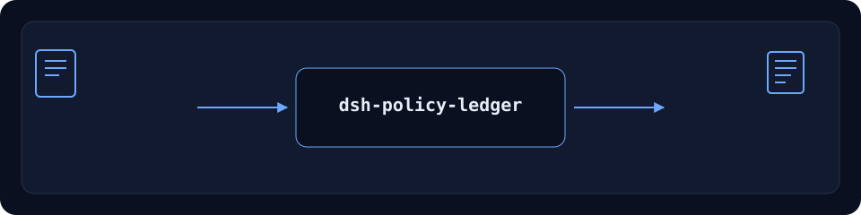

<div align="center">

# dsh-policy-ledger

> **Status: KEEP — install-only companion.** Not a duplicate of `dsh-plugin-doctor`: this answers "what is installed, what does the tarball contain, why did the install fail?" with a read-only capability snapshot, tarball assertions and install-log diagnosis. `dsh-plugin-doctor` does package-structure, cordis and sandbox-smoke checks. Use both when you need both questions answered.

[](https://www.npmjs.com/package/dsh-policy-ledger)
[](https://github.com/PerryLink/dsh-policy-ledger/actions)
[](LICENSE)
[](https://github.com/topics/dsh-plugin)
[](https://perrylink.github.io/dsh-plugins/)

**Doctor de instalación de solo lectura: instantánea de capacidades, verificación de tarball y diagnóstico.**

> **Estado: alpha / synthetic público / parcial / no contabilizado / no GA.** Sin evidencia de clientes, datos de clientes ni promesa de producción.

[English](README.md) · [简体中文](README-zh.md) · [Español](README-es.md) · [Português](README-pt.md) · [हिन्दी](README-hi.md)

```sh
dsh plugin --profile <profile> add dsh-policy-ledger
```

</div>



*Flujo: entrada local → plugin → salida local. No requiere llamada a un modelo.*

## Instalación

Instalar y verificar:

```sh
dsh plugin --profile <profile> add dsh-policy-ledger
dsh --profile <profile> --dump-config | grep dsh-policy-ledger
```

Desinstalar:

```sh
dsh plugin --profile <profile> remove dsh-policy-ledger
```

## Qué hace

Doctor de instalación de solo lectura: instantánea de capacidades, verificación de tarball y diagnóstico. Se ejecuta localmente en DeepSeek Harness. La tabla siguiente es la superficie exacta de herramientas; los ejemplos usan la interfaz real.

La entrada y la salida permanecen locales; no se sube nada.

## Herramientas

Los nombres y descripciones de herramientas se mantienen en inglés para coincidir con la salida runtime.

| Herramienta | Propósito (en inglés) | Riesgo |
|---|---|---|
| `trust.capability_snapshot` | Extract declared capabilities and R0–R3 risk from a local npm `.tgz`: tools, bundle/client/bin/skill, build scripts, outbound hosts, credential references | R0 local read |
| `trust.diff` | Compare two stored snapshots: added/removed capabilities, risk escalation, blockers | R0 |
| `trust.assert_tarball` | Re-read a tarball and compare it with a stored snapshot: pass/missing/extra/changed/unknown | R0 |
| `install.diagnose` | Classify an install log into stage, root cause and three actions; return unknown rather than guess | R0 |
| `install.probe` | Check disk free, write permission, proxy, optional registry RTT, node/pnpm | R0 |
| `install.bundle` | Write a redacted incident ZIP (diagnosis + evidence lines) | R1 local write |

## Inicio rápido

```sh
dsh plugin --profile <profile> add dsh-policy-ledger
dsh --profile <profile> --dump-config | grep dsh-policy-ledger
```

## Límites

- Solo público/sintético; sin datos ni evidencia de clientes.
- Alpha/parcial, no contabilizado, sin GA ni promesa de producción.
- Sin modelo ni red salvo que una herramienta lo indique.
- Los límites exactos están en la tabla y en `ACCEPTANCE.csv`.

## Muestra pública

Las fixtures públicas/sintéticas están en `test/fixtures/`; `ACCEPTANCE.csv` registra las comprobaciones con `counted=false`.

## Desarrollo

```sh
pnpm install --frozen-lockfile
pnpm build && pnpm lint && pnpm typecheck && pnpm test
```

## Familia

<details>
<summary>Familia de plugins DSH (15 paquetes + 2 suites)</summary>

| Package | npm |
|---|---|
| **[dsh-einvoice](https://github.com/PerryLink/dsh-einvoice)** | [npm](https://www.npmjs.com/package/dsh-einvoice) |
| **[dsh-docx-redline](https://github.com/PerryLink/dsh-docx-redline)** | [npm](https://www.npmjs.com/package/dsh-docx-redline) |
| **[dsh-policy-ledger](https://github.com/PerryLink/dsh-policy-ledger)** | [npm](https://www.npmjs.com/package/dsh-policy-ledger) |
| **[dsh-ghg](https://github.com/PerryLink/dsh-ghg)** | [npm](https://www.npmjs.com/package/dsh-ghg) |
| **[dsh-bankrec](https://github.com/PerryLink/dsh-bankrec)** | [npm](https://www.npmjs.com/package/dsh-bankrec) |
| **[dsh-ap-three-way](https://github.com/PerryLink/dsh-ap-three-way)** | [npm](https://www.npmjs.com/package/dsh-ap-three-way) |
| **[dsh-ifc-qto](https://github.com/PerryLink/dsh-ifc-qto)** | [npm](https://www.npmjs.com/package/dsh-ifc-qto) |
| **[dsh-qms-capa](https://github.com/PerryLink/dsh-qms-capa)** | [npm](https://www.npmjs.com/package/dsh-qms-capa) |
| **[dsh-legal-intake](https://github.com/PerryLink/dsh-legal-intake)** | [npm](https://www.npmjs.com/package/dsh-legal-intake) |
| **[dsh-legal-clause](https://github.com/PerryLink/dsh-legal-clause)** | [npm](https://www.npmjs.com/package/dsh-legal-clause) |
| **[dsh-freight-audit](https://github.com/PerryLink/dsh-freight-audit)** | [npm](https://www.npmjs.com/package/dsh-freight-audit) |
| **[dsh-hs-candidate](https://github.com/PerryLink/dsh-hs-candidate)** | [npm](https://www.npmjs.com/package/dsh-hs-candidate) |
| **[dsh-travel-recon](https://github.com/PerryLink/dsh-travel-recon)** | [npm](https://www.npmjs.com/package/dsh-travel-recon) |
| **[dsh-pim-lint](https://github.com/PerryLink/dsh-pim-lint)** | [npm](https://www.npmjs.com/package/dsh-pim-lint) |
| **[dsh-eval-pack](https://github.com/PerryLink/dsh-eval-pack)** | [npm](https://www.npmjs.com/package/dsh-eval-pack) |
| **[dsh-finops-suite](https://github.com/PerryLink/dsh-finops-suite)** | [npm](https://www.npmjs.com/package/dsh-finops-suite) |
| **[dsh-contract-suite](https://github.com/PerryLink/dsh-contract-suite)** | [npm](https://www.npmjs.com/package/dsh-contract-suite) |

</details>

## Licencia

Apache-2.0. See `LICENSE`, `NOTICE`, `THIRD-PARTY-NOTICES`.
