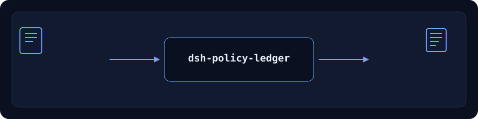

<div align="center">

# dsh-policy-ledger

> **आधिकारिक रिपॉज़िटरी।** इस पैकेज की एकमात्र आधिकारिक रिपॉज़िटरी, PerryLink द्वारा अनुरक्षित। अन्य खातों की समान-नाम वाली रिपॉज़िटरी संबद्ध नहीं हैं। Apache-2.0।

> **Status: KEEP — install-only companion.** Not a duplicate of `dsh-plugin-doctor`: this answers "what is installed, what does the tarball contain, why did the install fail?" with a read-only capability snapshot, tarball assertions and install-log diagnosis. `dsh-plugin-doctor` does package-structure, cordis and sandbox-smoke checks. Use both when you need both questions answered.

[](https://www.npmjs.com/package/dsh-policy-ledger)
[](https://github.com/PerryLink/dsh-policy-ledger/actions)
[](LICENSE)
[](https://github.com/topics/dsh-plugin)
[](https://perrylink.github.io/dsh-plugins/)
[](https://gitee.com/perrylink/dsh-plugins)
[](https://dshfind.com/plugins/PerryLink/dsh-policy-ledger?ref=badge)
[](https://dsh.market/)
[](#)
[](https://www.npmjs.com/package/dsh-policy-ledger)

**केवल-पढ़ने वाला इंस्टॉल डॉक्टर: क्षमता स्नैपशॉट, tarball जाँच और इंस्टॉल निदान।**

> **स्थिति: alpha / सार्वजनिक-सिंथेटिक / आंशिक / गिना नहीं गया / GA नहीं।** ग्राहक साक्ष्य, ग्राहक डेटा या उत्पादन-तैयारी का दावा नहीं।

[English](README.md) · [简体中文](README-zh.md) · [Español](README-es.md) · [Português](README-pt.md) · [हिन्दी](README-hi.md)

```sh
dsh plugin --profile <profile> add dsh-policy-ledger
```

</div>

> ⭐ अगर यह मदद करे, तो एक स्टार अगले व्यक्ति को इसे खोजने में आसानी देता है। स्टार से कोई सुविधा अनलॉक नहीं होती।



*वर्कफ़्लो: स्थानीय इनपुट → प्लगइन → स्थानीय आउटपुट। मॉडल कॉल आवश्यक नहीं।*

## इंस्टॉल

इंस्टॉल और सत्यापन:

```sh
dsh plugin --profile <profile> add dsh-policy-ledger
dsh --profile <profile> --dump-config | grep dsh-policy-ledger
```

अनइंस्टॉल:

```sh
dsh plugin --profile <profile> remove dsh-policy-ledger
```

## यह क्या करता है

केवल-पढ़ने वाला इंस्टॉल डॉक्टर: क्षमता स्नैपशॉट, tarball जाँच और इंस्टॉल निदान। DeepSeek Harness पर स्थानीय रूप से चलता है। नीचे दी गई तालिका ही सटीक टूल सतह है; उदाहरण वास्तविक कमांड का उपयोग करते हैं।

इनपुट और आउटपुट स्थानीय रहते हैं; कुछ अपलोड नहीं होता।

## टूल्स

टूल नाम और विवरण runtime आउटपुट से मेल खाने के लिए अंग्रेज़ी में रखे गए हैं।

| टूल | उद्देश्य (अंग्रेज़ी) | जोखिम |
|---|---|---|
| `trust.capability_snapshot` | Extract declared capabilities and R0–R3 risk from a local npm `.tgz`: tools, bundle/client/bin/skill, build scripts, outbound hosts, credential references | R0 local read |
| `trust.diff` | Compare two stored snapshots: added/removed capabilities, risk escalation, blockers | R0 |
| `trust.assert_tarball` | Re-read a tarball and compare it with a stored snapshot: pass/missing/extra/changed/unknown | R0 |
| `install.diagnose` | Classify an install log into stage, root cause and three actions; return unknown rather than guess | R0 |
| `install.probe` | Check disk free, write permission, proxy, optional registry RTT, node/pnpm | R0 |
| `install.bundle` | Write a redacted incident ZIP (diagnosis + evidence lines) | R1 local write |

## त्वरित शुरुआत

```sh
dsh plugin --profile <profile> add dsh-policy-ledger
dsh --profile <profile> --dump-config | grep dsh-policy-ledger
```

## सीमाएँ

- केवल सार्वजनिक/सिंथेटिक; ग्राहक डेटा या साक्ष्य नहीं।
- alpha/आंशिक, गिना नहीं गया, GA या उत्पादन-तैयारी का दावा नहीं।
- जब तक टूल स्पष्ट न कहे, मॉडल या नेटवर्क कॉल नहीं।
- सटीक सीमाएँ तालिका और `ACCEPTANCE.csv` में हैं।

## सार्वजनिक नमूना

सार्वजनिक/सिंथेटिक fixtures `test/fixtures/` में हैं; `ACCEPTANCE.csv` सार्वजनिक जाँचों को `counted=false` के साथ दर्ज करता है।

## विकास

```sh
pnpm install --frozen-lockfile
pnpm build && pnpm lint && pnpm typecheck && pnpm test
```

## संगतता

| सतह | स्थिति |
|---|---|
| Harness | `dsh >=0.2.1-rc.3 <0.3.0` |
| Node | `>=24.9.0 <25` |
| Platforms | All; local files only |
| डेटा | No network, no model call, no upload |

## अनुमतियाँ और डेटा

- स्थानीय रूप से चलता है; नेटवर्क, मॉडल कॉल या अपलोड नहीं।
- केवल सार्वजनिक/सिंथेटिक fixtures; ग्राहक डेटा या साक्ष्य नहीं।
- alpha/आंशिक; गिना नहीं गया, GA या उत्पादन-तैयारी का दावा नहीं।
- फ़्रीज़ पैकेज इंस्टॉल योग्य रहते हैं; नई सुविधाएँ नहीं, केवल वास्तविक खराबी।

## संबंधित कार्य

सहोदर पैकेज और परिवार सूचकांक: [dsh-pim-lint](https://github.com/PerryLink/dsh-pim-lint) · [dsh-eval-pack](https://github.com/PerryLink/dsh-eval-pack)

- [डोमेन सूचकांक](https://perrylink.github.io/dsh-plugins/)
- [चेकर परिवार](https://perrylink.github.io/zh/checkers/)
- [मुख्य परिवार](https://github.com/PerryLink/dsh-kit)

## परिवार

<details>
<summary>DSH डोमेन प्लगइन परिवार (15 पैकेज + 2 suites)</summary>

| Package | npm |
|---|---|
| **[dsh-einvoice](https://github.com/PerryLink/dsh-einvoice)** | [npm](https://www.npmjs.com/package/dsh-einvoice) |
| **[dsh-docx-redline](https://github.com/PerryLink/dsh-docx-redline)** | [npm](https://www.npmjs.com/package/dsh-docx-redline) |
| **[dsh-policy-ledger](https://github.com/PerryLink/dsh-policy-ledger)** | [npm](https://www.npmjs.com/package/dsh-policy-ledger) |
| **[dsh-ghg](https://github.com/PerryLink/dsh-ghg)** | [npm](https://www.npmjs.com/package/dsh-ghg) |
| **[dsh-bankrec](https://github.com/PerryLink/dsh-bankrec)** | [npm](https://www.npmjs.com/package/dsh-bankrec) |
| **[dsh-ap-three-way](https://github.com/PerryLink/dsh-ap-three-way)** | [npm](https://www.npmjs.com/package/dsh-ap-three-way) |
| **[dsh-ifc-qto](https://github.com/PerryLink/dsh-ifc-qto)** | [npm](https://www.npmjs.com/package/dsh-ifc-qto) |
| **[dsh-qms-capa](https://github.com/PerryLink/dsh-qms-capa)** | [npm](https://www.npmjs.com/package/dsh-qms-capa) |
| **[dsh-legal-intake](https://github.com/PerryLink/dsh-legal-intake)** | [npm](https://www.npmjs.com/package/dsh-legal-intake) |
| **[dsh-legal-clause](https://github.com/PerryLink/dsh-legal-clause)** | [npm](https://www.npmjs.com/package/dsh-legal-clause) |
| **[dsh-freight-audit](https://github.com/PerryLink/dsh-freight-audit)** | [npm](https://www.npmjs.com/package/dsh-freight-audit) |
| **[dsh-hs-candidate](https://github.com/PerryLink/dsh-hs-candidate)** | [npm](https://www.npmjs.com/package/dsh-hs-candidate) |
| **[dsh-travel-recon](https://github.com/PerryLink/dsh-travel-recon)** | [npm](https://www.npmjs.com/package/dsh-travel-recon) |
| **[dsh-pim-lint](https://github.com/PerryLink/dsh-pim-lint)** | [npm](https://www.npmjs.com/package/dsh-pim-lint) |
| **[dsh-eval-pack](https://github.com/PerryLink/dsh-eval-pack)** | [npm](https://www.npmjs.com/package/dsh-eval-pack) |
| **[dsh-finops-suite](https://github.com/PerryLink/dsh-finops-suite)** | [npm](https://www.npmjs.com/package/dsh-finops-suite) |
| **[dsh-contract-suite](https://github.com/PerryLink/dsh-contract-suite)** | [npm](https://www.npmjs.com/package/dsh-contract-suite) |

</details>

## लाइसेंस

Apache-2.0. See `LICENSE`, `NOTICE`, `THIRD-PARTY-NOTICES`.
