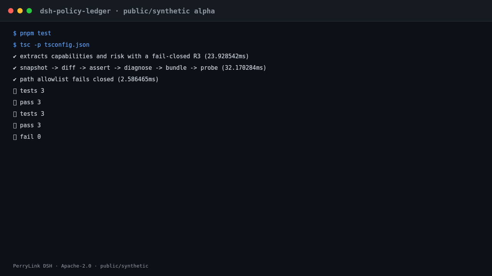

<div align="center">

# dsh-policy-ledger

> **官方仓库。** 本包唯一官方仓库，由 PerryLink 维护；其他账号下的同名仓库与本项目无关。Apache-2.0。

> **状态：保留 — 仅安装诊断的伴生工具。** 与 `dsh-plugin-doctor` 不重复：本包回答“装了什么、tarball 里有什么、为什么安装失败”，只读能力快照、tarball 断言和安装日志诊断；`dsh-plugin-doctor` 做包结构、Cordis 和 sandbox smoke。需要两类问题时同时用。

[](https://www.npmjs.com/package/dsh-policy-ledger)
[](https://github.com/PerryLink/dsh-policy-ledger/actions)
[](LICENSE)
[](https://github.com/topics/dsh-plugin)
[](https://perrylink.github.io/dsh-plugins/)
[](https://gitee.com/perrylink/dsh-plugins)
[](https://dshfind.com/plugins/PerryLink/dsh-policy-ledger?ref=badge)
[](https://dsh.market/)
[](#)
[](https://www.npmjs.com/package/dsh-policy-ledger)

**只读安装诊断：能力快照、tarball 断言与安装日志分类。**

> **状态：alpha / 公开合成 / partial / not counted / 非 GA。** 不含客户证据、客户数据，也不作生产可用声明。

[English](README.md) · [简体中文](README-zh.md) · [Español](README-es.md) · [Português](README-pt.md) · [हिन्दी](README-hi.md)

```sh
dsh plugin --profile <profile> add dsh-policy-ledger
```

</div>

> ⭐ 如果它帮到了你，点个 star 会让下一个人更容易找到它；没有任何功能被 star 解锁。


*工作流：本地输入 → 插件 → 本地输出；不需要调用模型。*



*本地真实测试运行；不调用模型或网络。*

## 一句话

对本地 npm 包做一次只读体检：抽出能力、给出风险等级，并解释安装日志。

## 适合 / 不适合

- **适合**：安装第三方 DSH 包前，想先看它声明了哪些能力（tools / bundle / bin / 网络 / 凭据）；或者安装失败，想读懂日志卡在哪一步。
- **不适合**：需要自动执行 tarball、修改 profile、或替你做放行决定的场景；本包只读，不做拦截。

## 输入

- 本地 npm tarball（`.tgz`，由 `npm pack` / `pnpm pack` 生成），必须位于 `DSH_TRUST_INPUT_ROOTS` 指定的目录（默认当前工作目录）下。
- 安装日志纯文本（UTF-8），原样传入即可。
- 自带样例在 `samples/quickstart/input/`：一个 524 字节的合成 tarball + 一份合成安装日志，远小于 500 KB。
- 硬上限：单个 `.tgz` 8 MiB，解压后 32 MiB；超过会以 `E_TRUST_ARCHIVE_LIMIT` / `E_TRUST_TARBALL_LIMIT` 拒绝。

## 输出

- 能力快照：`name` / `version` / `integrity` / `risk` / `capabilities` / `tool_names` / `outbound_hosts` / `cred_refs` / `build_scripts` / `unknowns`。
- tarball 断言：逐条给出 `pass` / `missing` / `extra` / `changed`，不会把不一致当成通过。
- 安装诊断：`stage`、`error_code`、`root_cause`、三条 `actions` 与 `confidence`；证据不足时返回 unknown 而不是猜测。
- 可选证据包：`$DSH_HOME/storages/dsh-policy-ledger/bundles/<incident>-<sha>.zip`，日志先脱敏再写入；不改原 tarball。

## 示例

直接复制这句话：

> 帮我用自带样例做一次安装体检：这个包有什么能力、风险几级、装失败的那行日志是什么原因？

也可以自己跑（真实运行，截图即来自这条命令）：

```sh
node samples/quickstart/run.mjs
```


*合成 tarball → 金标 `samples/quickstart/expected/result.json`；命令与哈希见 `screenshots.json`。*

## 权限

- 读：你指定的本地 `.tgz` 与安装日志（由会话读取后作为参数传入）；不读其他目录
- 写：`$DSH_HOME/storages/dsh-policy-ledger`（快照/事件记录与 `bundles/*.zip`）；不改原文件
- 联网：是（可选；仅 `install.probe` 传 `network: true` 时访问 `registry.npmjs.org` 做一次 5 秒超时的 ping，默认关闭）
- 外部系统：无（不发布、不上传；证据包只写本地）

`install.bundle` 标 **R1（本地写）**，其余工具标 **R0（只读）**；逐项见下方工具表。

## FAQ

### 装不上怎么办？

确认 DSH `>=0.2.1-rc.3 <0.4.0`、Node `>=24.9 <25`，并用全新的 `DSH_HOME` 重试；完整步骤见 `TROUBLESHOOTING.md`。

### 为什么风险等级是 R2 而不是 R0？

风险按声明能力累加：bundle patch 记 1 分、bin 记 1 分、构建脚本 / 出站主机 / 凭据各记 2 分；2 分就是 R2。样例包同时声明了 bundle 和 bin，所以是 R2。

### 路径被拒绝（E_TRUST_PATH_NOT_ALLOWED）怎么办？

工具只读 `DSH_TRUST_INPUT_ROOTS` 下的文件。把 tarball 放进该目录，或在该目录里运行；不要直接把 `/etc/hosts` 这类路径传进来。

### 能处理我的真实 npm 包吗？

可以本地运行，但本包是 alpha、只用公开/合成包验证，不构成安全认证；真实包请结合源码与发布者信息人工复核。

### 会联网吗？

默认不联网。只有显式调用 `install.probe` 并传 `network: true` 时，才会对 `registry.npmjs.org` 做一次 5 秒超时的连通性 ping；结果不影响其他工具。

## 版本

- 当前版本：`0.2.0-alpha.14`（与 `package.json` 一致）
- 测试：`node --test test/*.test.mjs` 全绿（16 个用例，0 失败）

## 安装

安装并验证：

```sh
dsh plugin --profile <profile> add dsh-policy-ledger
dsh --profile <profile> --dump-config | grep dsh-policy-ledger
```

卸载：

```sh
dsh plugin --profile <profile> remove dsh-policy-ledger
```


### 安装通道

推荐 npm；其他通道用于固定版本或离线。

- **npm（推荐）:** `dsh plugin --profile <profile> add dsh-policy-ledger`
- **git 通道:** `dsh plugin --profile <profile> add github:PerryLink/dsh-policy-ledger`
- **tarball:** `pnpm pack` then `dsh plugin --profile <profile> add ./dsh-policy-ledger-<version>.tgz`
- **1024 商店:** `npm i -g dsh1024` then `dsh1024 plugin --profile <profile> add dsh-policy-ledger`

## 它做什么

只读安装诊断：能力快照、tarball 断言与安装日志分类。 在 DeepSeek Harness 本地运行；下表就是实际工具面，示例使用真实命令面。

输入和输出都留在本地，不上传。

## 工具

工具名是稳定 API；说明已本地化。

| 工具 | 用途 | 风险 |
|---|---|---|
| `trust.capability_snapshot` | 从本地 npm `.tgz` 中提取声明的能力与 R0–R3 风险：tools、bundle/client/bin/skill、构建脚本、出站主机、凭据引用 | R0 local read |
| `trust.diff` | 比较两个已保存快照：新增/移除的能力、风险升级、阻断项 | R0 |
| `trust.assert_tarball` | 重新读取 tarball 并与已保存快照比对：通过/缺失/多余/变更/未知 | R0 |
| `install.diagnose` | 将安装日志归类为阶段、根因和三条行动建议；无法判断时返回未知而非猜测 | R0 |
| `install.probe` | 检查磁盘可用空间、写权限、代理、可选的 registry RTT 以及 node/pnpm | R0 |
| `install.bundle` | 写出经脱敏的事件 ZIP（诊断 + 证据行） | R1 local write |
| `trust.risk_report` | 拆解风险分数：每个因子的分值、总分与 R0–R3 结论 | R0 |
| `trust.risk_matrix` | 车队视图：按 R0–R3 计数、最高等级与需要复核的包 | R0 |
| `trust.assert` | `trust.assert_tarball` 的弃用别名（语义相同） | R0 |

## 快速开始

```sh
dsh plugin --profile <profile> add dsh-policy-ledger
dsh --profile <profile> --dump-config | grep dsh-policy-ledger
```

## 验收

### fixture 支撑的验收行

输入: [`ACCEPTANCE.csv`](https://github.com/PerryLink/dsh-policy-ledger/blob/main/ACCEPTANCE.csv)

命令: `pnpm test`

验收行:

| req_id | metric | threshold | actual | pass | source | counted |
|---|---|---|---|---|---|---|
| SKU-03-A01 | 能力快照抽取（3 包） | 3/3 | 3 | true | public/synthetic | false |

*这是 fixture 支撑的验收行，不是客户运行；没有编造输出。*

## 边界

- 仅公开/合成样例；不含客户数据或客户证据。
- alpha/partial、not counted，不作 GA 或生产可用声明。
- 除非工具明确说明，否则不调用模型、不联网。
- 每个工具的精确边界见工具表与 `ACCEPTANCE.csv`。

## 公开样例

- `samples/quickstart/`：随 npm 包一起发布的合成样例（tarball + 安装日志 + 金标），`node samples/quickstart/run.mjs --check` 可直接复现金标；`scripts/build-quickstart-tarball.mjs --check` 可验证合成 tarball 可复现。
- `ACCEPTANCE.csv` 记录公开检查，除 `PS1-QS01` 外全部 `counted=false`。

## 开发

```sh
pnpm install --frozen-lockfile
pnpm build && pnpm lint && pnpm typecheck && pnpm test
```

## 兼容性

| 维度 | 状态 |
|---|---|
| Harness | `dsh >=0.2.1-rc.3 <0.3.0` |
| Node | `>=24.9.0 <25` |
| Platforms | All; local files only |
| 数据 | Local files only; optional registry ping only when `install.probe` is called with `network: true`; no model call, no upload |

## 权限与数据

- 默认本地运行；只有显式调用 `install.probe` 且传 `network: true` 时才访问 `registry.npmjs.org` 做连通性 ping；不调用模型、不上传。
- 只使用公开/合成 fixture；不含客户数据或客户证据。
- alpha/partial；not counted，不作 GA 或生产可用声明。

## 相关项目

兄弟包与家族索引： [dsh-pim-lint](https://github.com/PerryLink/dsh-pim-lint) · [dsh-eval-pack](https://github.com/PerryLink/dsh-eval-pack)

相关工具（英文表）: [Related tools](README.md#related-tools).

- [故障排查（英文）](TROUBLESHOOTING.md)
- [领域索引](https://perrylink.github.io/dsh-plugins/)
- [Checker 家族](https://perrylink.github.io/zh/checkers/)
- [主线家族](https://github.com/PerryLink/dsh-kit)

## 家族

<details>
<summary>DSH 领域插件家族（15 个包 + 2 个 suite）</summary>

| Package | npm |
|---|---|
| **[dsh-einvoice](https://github.com/PerryLink/dsh-einvoice)** | [npm](https://www.npmjs.com/package/dsh-einvoice) |
| **[dsh-docx-redline](https://github.com/PerryLink/dsh-docx-redline)** | [npm](https://www.npmjs.com/package/dsh-docx-redline) |
| **[dsh-policy-ledger](https://github.com/PerryLink/dsh-policy-ledger)** | [npm](https://www.npmjs.com/package/dsh-policy-ledger) |
| **[dsh-ghg](https://github.com/PerryLink/dsh-ghg)** | [npm](https://www.npmjs.com/package/dsh-ghg) |
| **[dsh-bankrec](https://github.com/PerryLink/dsh-bankrec)** | [npm](https://www.npmjs.com/package/dsh-bankrec) |
| **[dsh-ap-three-way](https://github.com/PerryLink/dsh-ap-three-way)** | [npm](https://www.npmjs.com/package/dsh-ap-three-way) |
| **[dsh-ifc-qto](https://github.com/PerryLink/dsh-ifc-qto)** | [npm](https://www.npmjs.com/package/dsh-ifc-qto) |
| **[dsh-qms-capa](https://github.com/PerryLink/dsh-qms-capa)** | [npm](https://www.npmjs.com/package/dsh-qms-capa) |
| **[dsh-legal-intake](https://github.com/PerryLink/dsh-legal-intake)** | [npm](https://www.npmjs.com/package/dsh-legal-intake) |
| **[dsh-legal-clause](https://github.com/PerryLink/dsh-legal-clause)** | [npm](https://www.npmjs.com/package/dsh-legal-clause) |
| **[dsh-freight-audit](https://github.com/PerryLink/dsh-freight-audit)** | [npm](https://www.npmjs.com/package/dsh-freight-audit) |
| **[dsh-hs-candidate](https://github.com/PerryLink/dsh-hs-candidate)** | [npm](https://www.npmjs.com/package/dsh-hs-candidate) |
| **[dsh-travel-recon](https://github.com/PerryLink/dsh-travel-recon)** | [npm](https://www.npmjs.com/package/dsh-travel-recon) |
| **[dsh-pim-lint](https://github.com/PerryLink/dsh-pim-lint)** | [npm](https://www.npmjs.com/package/dsh-pim-lint) |
| **[dsh-eval-pack](https://github.com/PerryLink/dsh-eval-pack)** | [npm](https://www.npmjs.com/package/dsh-eval-pack) |
| **[dsh-finops-suite](https://github.com/PerryLink/dsh-finops-suite)** | [npm](https://www.npmjs.com/package/dsh-finops-suite) |
| **[dsh-contract-suite](https://github.com/PerryLink/dsh-contract-suite)** | [npm](https://www.npmjs.com/package/dsh-contract-suite) |

</details>


<details>
<summary>主线家族 — 92 个当前安装 spec</summary>

| Package | npm |
|---|---|
| **[dsh-aqua-input-check](https://github.com/PerryLink/dsh-aqua-input-check)** | [npm](https://www.npmjs.com/package/dsh-aqua-input-check) |
| **[dsh-archive-check](https://github.com/PerryLink/dsh-archive-check)** | [npm](https://www.npmjs.com/package/dsh-archive-check) |
| **[dsh-bid-ca-precheck](https://github.com/PerryLink/dsh-bid-ca-precheck)** | [npm](https://www.npmjs.com/package/dsh-bid-ca-precheck) |
| **[dsh-bid-qual-check](https://github.com/PerryLink/dsh-bid-qual-check)** | [npm](https://www.npmjs.com/package/dsh-bid-qual-check) |
| **[dsh-contract-stance](https://github.com/PerryLink/dsh-contract-stance)** | [npm](https://www.npmjs.com/package/dsh-contract-stance) |
| **[dsh-customs-doc-check](https://github.com/PerryLink/dsh-customs-doc-check)** | [npm](https://www.npmjs.com/package/dsh-customs-doc-check) |
| **[dsh-demurrage-ledger](https://github.com/PerryLink/dsh-demurrage-ledger)** | [npm](https://www.npmjs.com/package/dsh-demurrage-ledger) |
| **[dsh-drill-script-check](https://github.com/PerryLink/dsh-drill-script-check)** | [npm](https://www.npmjs.com/package/dsh-drill-script-check) |
| **[dsh-eia-guide-check](https://github.com/PerryLink/dsh-eia-guide-check)** | [npm](https://www.npmjs.com/package/dsh-eia-guide-check) |
| **[dsh-emergency-plan](https://github.com/PerryLink/dsh-emergency-plan)** | [npm](https://www.npmjs.com/package/dsh-emergency-plan) |
| **[dsh-essay-rubric-check](https://github.com/PerryLink/dsh-essay-rubric-check)** | [npm](https://www.npmjs.com/package/dsh-essay-rubric-check) |
| **[dsh-evidence-check](https://github.com/PerryLink/dsh-evidence-check)** | [npm](https://www.npmjs.com/package/dsh-evidence-check) |
| **[dsh-export-ctl-check](https://github.com/PerryLink/dsh-export-ctl-check)** | [npm](https://www.npmjs.com/package/dsh-export-ctl-check) |
| **[dsh-fmea-table-check](https://github.com/PerryLink/dsh-fmea-table-check)** | [npm](https://www.npmjs.com/package/dsh-fmea-table-check) |
| **[dsh-forecast-penalty](https://github.com/PerryLink/dsh-forecast-penalty)** | [npm](https://www.npmjs.com/package/dsh-forecast-penalty) |
| **[dsh-gongwen-flow-check](https://github.com/PerryLink/dsh-gongwen-flow-check)** | [npm](https://www.npmjs.com/package/dsh-gongwen-flow-check) |
| **[dsh-gongwen-word-check](https://github.com/PerryLink/dsh-gongwen-word-check)** | [npm](https://www.npmjs.com/package/dsh-gongwen-word-check) |
| **[dsh-guard-plan-qc](https://github.com/PerryLink/dsh-guard-plan-qc)** | [npm](https://www.npmjs.com/package/dsh-guard-plan-qc) |
| **[dsh-hazchem-check](https://github.com/PerryLink/dsh-hazchem-check)** | [npm](https://www.npmjs.com/package/dsh-hazchem-check) |
| **[dsh-hazplan-check](https://github.com/PerryLink/dsh-hazplan-check)** | [npm](https://www.npmjs.com/package/dsh-hazplan-check) |
| **[dsh-hidden-risk-map](https://github.com/PerryLink/dsh-hidden-risk-map)** | [npm](https://www.npmjs.com/package/dsh-hidden-risk-map) |
| **[dsh-hs-classify](https://github.com/PerryLink/dsh-hs-classify)** | [npm](https://www.npmjs.com/package/dsh-hs-classify) |
| **[dsh-icd-rule-check](https://github.com/PerryLink/dsh-icd-rule-check)** | [npm](https://www.npmjs.com/package/dsh-icd-rule-check) |
| **[dsh-lawcite-adapter](https://github.com/PerryLink/dsh-lawcite-adapter)** | [npm](https://www.npmjs.com/package/dsh-lawcite-adapter) |
| **[dsh-lc-doc-check](https://github.com/PerryLink/dsh-lc-doc-check)** | [npm](https://www.npmjs.com/package/dsh-lc-doc-check) |
| **[dsh-learning-gap-check](https://github.com/PerryLink/dsh-learning-gap-check)** | [npm](https://www.npmjs.com/package/dsh-learning-gap-check) |
| **[dsh-medrec-qc](https://github.com/PerryLink/dsh-medrec-qc)** | [npm](https://www.npmjs.com/package/dsh-medrec-qc) |
| **[dsh-nsfc-form-check](https://github.com/PerryLink/dsh-nsfc-form-check)** | [npm](https://www.npmjs.com/package/dsh-nsfc-form-check) |
| **[dsh-nurse-record-check](https://github.com/PerryLink/dsh-nurse-record-check)** | [npm](https://www.npmjs.com/package/dsh-nurse-record-check) |
| **[dsh-origin-rvc-check](https://github.com/PerryLink/dsh-origin-rvc-check)** | [npm](https://www.npmjs.com/package/dsh-origin-rvc-check) |
| **[dsh-ota-review-check](https://github.com/PerryLink/dsh-ota-review-check)** | [npm](https://www.npmjs.com/package/dsh-ota-review-check) |
| **[dsh-paper-doc-adapter](https://github.com/PerryLink/dsh-paper-doc-adapter)** | [npm](https://www.npmjs.com/package/dsh-paper-doc-adapter) |
| **[dsh-permit-report-check](https://github.com/PerryLink/dsh-permit-report-check)** | [npm](https://www.npmjs.com/package/dsh-permit-report-check) |
| **[dsh-pipeline-check](https://github.com/PerryLink/dsh-pipeline-check)** | [npm](https://www.npmjs.com/package/dsh-pipeline-check) |
| **[dsh-pleading-draft](https://github.com/PerryLink/dsh-pleading-draft)** | [npm](https://www.npmjs.com/package/dsh-pleading-draft) |
| **[dsh-policy-brief-draft](https://github.com/PerryLink/dsh-policy-brief-draft)** | [npm](https://www.npmjs.com/package/dsh-policy-brief-draft) |
| **[dsh-power-loss-split](https://github.com/PerryLink/dsh-power-loss-split)** | [npm](https://www.npmjs.com/package/dsh-power-loss-split) |
| **[dsh-power-ticket-check](https://github.com/PerryLink/dsh-power-ticket-check)** | [npm](https://www.npmjs.com/package/dsh-power-ticket-check) |
| **[dsh-ppap-check](https://github.com/PerryLink/dsh-ppap-check)** | [npm](https://www.npmjs.com/package/dsh-ppap-check) |
| **[dsh-protest-deadline](https://github.com/PerryLink/dsh-protest-deadline)** | [npm](https://www.npmjs.com/package/dsh-protest-deadline) |
| **[dsh-railway-window](https://github.com/PerryLink/dsh-railway-window)** | [npm](https://www.npmjs.com/package/dsh-railway-window) |
| **[dsh-repair-order-qc](https://github.com/PerryLink/dsh-repair-order-qc)** | [npm](https://www.npmjs.com/package/dsh-repair-order-qc) |
| **[dsh-review-reply-check](https://github.com/PerryLink/dsh-review-reply-check)** | [npm](https://www.npmjs.com/package/dsh-review-reply-check) |
| **[dsh-rulefile-check](https://github.com/PerryLink/dsh-rulefile-check)** | [npm](https://www.npmjs.com/package/dsh-rulefile-check) |
| **[dsh-safety-brief-check](https://github.com/PerryLink/dsh-safety-brief-check)** | [npm](https://www.npmjs.com/package/dsh-safety-brief-check) |
| **[dsh-site-log-check](https://github.com/PerryLink/dsh-site-log-check)** | [npm](https://www.npmjs.com/package/dsh-site-log-check) |
| **[dsh-soe-decision-check](https://github.com/PerryLink/dsh-soe-decision-check)** | [npm](https://www.npmjs.com/package/dsh-soe-decision-check) |
| **[dsh-soilwater-check](https://github.com/PerryLink/dsh-soilwater-check)** | [npm](https://www.npmjs.com/package/dsh-soilwater-check) |
| **[dsh-sop-sync-check](https://github.com/PerryLink/dsh-sop-sync-check)** | [npm](https://www.npmjs.com/package/dsh-sop-sync-check) |
| **[dsh-spc-gbt-adapter](https://github.com/PerryLink/dsh-spc-gbt-adapter)** | [npm](https://www.npmjs.com/package/dsh-spc-gbt-adapter) |
| **[dsh-tender-extract](https://github.com/PerryLink/dsh-tender-extract)** | [npm](https://www.npmjs.com/package/dsh-tender-extract) |
| **[dsh-tender-matrix](https://github.com/PerryLink/dsh-tender-matrix)** | [npm](https://www.npmjs.com/package/dsh-tender-matrix) |
| **[dsh-warranty-calc](https://github.com/PerryLink/dsh-warranty-calc)** | [npm](https://www.npmjs.com/package/dsh-warranty-calc) |
| **[dsh-auto-review](https://github.com/PerryLink/dsh-auto-review)** | [npm](https://www.npmjs.com/package/dsh-auto-review) |
| **[dsh-autotier](https://github.com/PerryLink/dsh-autotier)** | [npm](https://www.npmjs.com/package/dsh-autotier) |
| **[dsh-budget](https://github.com/PerryLink/dsh-budget)** | [npm](https://www.npmjs.com/package/dsh-budget) |
| **[dsh-cert-mcp](https://github.com/PerryLink/dsh-cert-mcp)** | [npm](https://www.npmjs.com/package/dsh-cert-mcp) |
| **[dsh-checkpoint-rewind](https://github.com/PerryLink/dsh-checkpoint-rewind)** | [npm](https://www.npmjs.com/package/dsh-checkpoint-rewind) |
| **[dsh-claude-move](https://github.com/PerryLink/dsh-claude-move)** | [npm](https://www.npmjs.com/package/dsh-claude-move) |
| **[dsh-click](https://github.com/PerryLink/dsh-click)** | [npm](https://www.npmjs.com/package/dsh-click) |
| **[dsh-composer-history](https://github.com/PerryLink/dsh-composer-history)** | [npm](https://www.npmjs.com/package/dsh-composer-history) |
| **[dsh-data-quality](https://github.com/PerryLink/dsh-data-quality)** | [npm](https://www.npmjs.com/package/dsh-data-quality) |
| **[dsh-defend](https://github.com/PerryLink/dsh-defend)** | [npm](https://www.npmjs.com/package/dsh-defend) |
| **[dsh-doublecheck](https://github.com/PerryLink/dsh-doublecheck)** | [npm](https://www.npmjs.com/package/dsh-doublecheck) |
| **[dsh-draw](https://github.com/PerryLink/dsh-draw)** | [npm](https://www.npmjs.com/package/dsh-draw) |
| **[dsh-fast](https://github.com/PerryLink/dsh-fast)** | [npm](https://www.npmjs.com/package/dsh-fast) |
| **[dsh-fund-research](https://github.com/PerryLink/dsh-fund-research)** | [npm](https://www.npmjs.com/package/dsh-fund-research) |
| **[dsh-industry-research](https://github.com/PerryLink/dsh-industry-research)** | [npm](https://www.npmjs.com/package/dsh-industry-research) |
| **[dsh-laya](https://github.com/PerryLink/dsh-laya)** | [npm](https://www.npmjs.com/package/dsh-laya) |
| **[dsh-library](https://github.com/PerryLink/dsh-library)** | [npm](https://www.npmjs.com/package/dsh-library) |
| **[dsh-local-ai](https://github.com/PerryLink/dsh-local-ai)** | [npm](https://www.npmjs.com/package/dsh-local-ai) |
| **[dsh-lsp-actions](https://github.com/PerryLink/dsh-lsp-actions)** | [npm](https://www.npmjs.com/package/dsh-lsp-actions) |
| **[dsh-mask](https://github.com/PerryLink/dsh-mask)** | [npm](https://www.npmjs.com/package/dsh-mask) |
| **[dsh-mcp-panel](https://github.com/PerryLink/dsh-mcp-panel)** | [npm](https://www.npmjs.com/package/dsh-mcp-panel) |
| **[dsh-memento](https://github.com/PerryLink/dsh-memento)** | [npm](https://www.npmjs.com/package/dsh-memento) |
| **[dsh-observe](https://github.com/PerryLink/dsh-observe)** | [npm](https://www.npmjs.com/package/dsh-observe) |
| **[dsh-output-styles](https://github.com/PerryLink/dsh-output-styles)** | [npm](https://www.npmjs.com/package/dsh-output-styles) |
| **[dsh-permission-rules](https://github.com/PerryLink/dsh-permission-rules)** | [npm](https://www.npmjs.com/package/dsh-permission-rules) |
| **[dsh-plugin-guide](https://github.com/PerryLink/dsh-plugin-guide)** | [npm](https://www.npmjs.com/package/dsh-plugin-guide) |
| **[dsh-plugin-upgrade](https://github.com/PerryLink/dsh-plugin-upgrade)** | [npm](https://www.npmjs.com/package/dsh-plugin-upgrade) |
| **[dsh-reach](https://github.com/PerryLink/dsh-reach)** | [npm](https://www.npmjs.com/package/dsh-reach) |
| **[dsh-research-report](https://github.com/PerryLink/dsh-research-report)** | [npm](https://www.npmjs.com/package/dsh-research-report) |
| **[dsh-score](https://github.com/PerryLink/dsh-score)** | [npm](https://www.npmjs.com/package/dsh-score) |
| **[dsh-session-sync](https://github.com/PerryLink/dsh-session-sync)** | [npm](https://www.npmjs.com/package/dsh-session-sync) |
| **[dsh-talk](https://github.com/PerryLink/dsh-talk)** | [npm](https://www.npmjs.com/package/dsh-talk) |
| **[dsh-test-drive](https://github.com/PerryLink/dsh-test-drive)** | [npm](https://www.npmjs.com/package/dsh-test-drive) |
| **[dsh-translate](https://github.com/PerryLink/dsh-translate)** | [npm](https://www.npmjs.com/package/dsh-translate) |
| **[](https://github.com/PerryLink/)** | [npm](https://www.npmjs.com/package/) |
| **[](https://github.com/PerryLink/)** | [npm](https://www.npmjs.com/package/) |
| **[](https://github.com/PerryLink/)** | [npm](https://www.npmjs.com/package/) |
| **[](https://github.com/PerryLink/)** | [npm](https://www.npmjs.com/package/) |
| **[](https://github.com/PerryLink/)** | [npm](https://www.npmjs.com/package/) |

</details>

## 许可证

Apache-2.0. See `LICENSE`, `NOTICE`, `THIRD-PARTY-NOTICES`.
