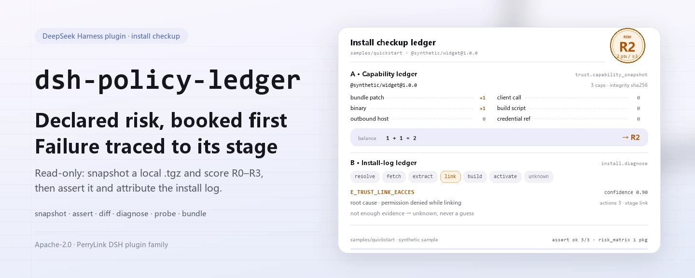
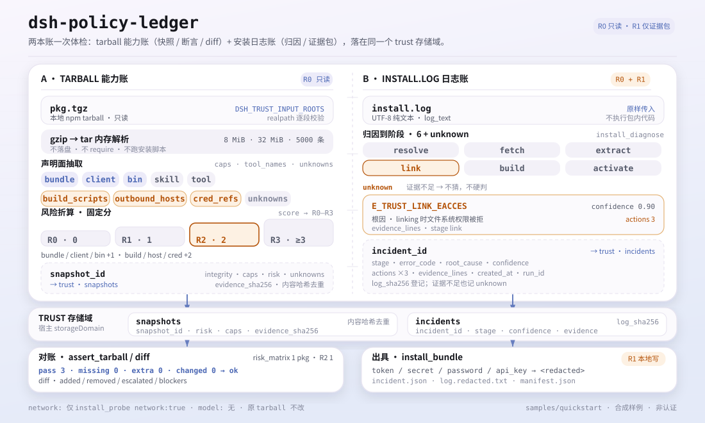

<div align="center">

<picture>
  <source media="(prefers-color-scheme: dark)" srcset="docs/assets/dsh-policy-ledger-hero-en-dark.webp">
  
</picture>

# dsh-policy-ledger

**Before you install a third-party DSH package, see what capabilities it declares, how risky it is, and why an install failed — read-only, and nothing in your environment changes.**

A read-only install doctor for DeepSeek Harness: extract declared capabilities and an R0–R3 risk level from a local npm tarball, assert the tarball against a stored snapshot row by row, and classify an install log into stage, root cause and three next actions.

[Install](#three-step-setup) · [Configuration](#configuration) · [FAQ](#faq) · [简体中文](README.md) · [English](README.en.md) · [Español](README.es.md) · [Português](README.pt.md) · [हिन्दी](README.hi.md)

[](LICENSE)
[](#compatibility)
[](https://www.npmjs.com/package/dsh-policy-ledger)
[](https://github.com/PerryLink/dsh-policy-ledger/actions/workflows/ci.yml)
[](#compatibility)

[](https://github.com/PerryLink/dsh-policy-ledger/stargazers)
[](https://www.npmjs.com/package/dsh-policy-ledger)
[](https://dshfind.com/plugins/PerryLink/dsh-policy-ledger?ref=badge)
[](https://dsh.market/)
[](https://gitee.com/perrylink/dsh-policy-ledger)

```sh
dsh plugin --profile <profile> add dsh-policy-ledger
```

</div>

<sub>Community plugin, not affiliated with DeepSeek. Canonical repository: <https://github.com/PerryLink/dsh-policy-ledger> (Gitee is a mirror).</sub>

> **Status: alpha / public-synthetic / partial / not counted / not GA.** No customer evidence, customer data, or production-readiness claim.

## What it is

`dsh-policy-ledger` runs a read-only checkup before you install a third-party DSH package: it extracts what the local npm `.tgz` declares (tools, bundle/client/bin/skill, build scripts, outbound hosts, credential references) and turns that into an R0–R3 risk level by fixed rules. When an install fails, it classifies the log into one of `resolve` / `fetch` / `extract` / `link` / `build` / `activate`, returning a root cause and three next actions. Inputs and outputs stay on your machine: no model calls, no network by default, the original tarball is untouched, and no package code is executed. It answers "what is installed, what does the tarball contain, why did the install fail" — not package-structure, Cordis-wiring or sandbox-smoke checks, which belong to the archived `dsh-plugin-doctor`; use both when you need both questions answered.

<picture>
  <source media="(prefers-color-scheme: dark)" srcset="docs/assets/dsh-policy-ledger-flow-v5-dark.svg">
  
</picture>

*Figure: both ledgers share the trust storage domain; R0–R3 scores the declared surface only, not a security certification.*

- **Good fit**: seeing declared capabilities and risk before installing a third-party DSH package; reading an install log to find where it stopped; producing a redacted incident bundle you can forward.
- **Not a fit**: automatically executing a tarball, repairing an install, or making an allow/block decision for you; this package diagnoses read-only and is not a policy gate.

## Three-step setup

1. **Install** (pick one channel):

   ```sh
   # npm channel (recommended; published releases)
   dsh plugin --profile <profile> add dsh-policy-ledger
   # git channel (latest main; equivalent to git+https://github.com/PerryLink/dsh-policy-ledger.git)
   dsh plugin --profile <profile> add github:PerryLink/dsh-policy-ledger
   # tarball channel: pnpm pack in this repo, then
   dsh plugin --profile <profile> add ./dsh-policy-ledger-<version>.tgz
   ```

2. **Minimal config**: there are no config keys — `cordis.patch.yml` only `insert`s one row, and the defaults are all you need. By default only `.tgz` files and install logs under the host process working directory are readable; set `DSH_TRUST_INPUT_ROOTS` to change that (see "Configuration").

3. **Verify it works**:

   ```sh
   dsh --profile <profile> --dump-config | grep dsh-policy-ledger
   node samples/quickstart/run.mjs
   ```

   The quickstart runs capability snapshot → tarball assert → risk breakdown → install-log diagnosis → fleet risk matrix over the bundled synthetic sample and compares against the golden `samples/quickstart/expected/result.json`. In the repository, run `pnpm build` first to produce `lib/` (the published package already ships the build output).

**Uninstall**: `dsh plugin --profile <profile> remove dsh-policy-ledger` (or remove the row from the profile patch).

<details>
<summary>Install from the DSH Desktop market</summary>

Every PerryLink plugin is listed in the built-in DSH Desktop market: **Market → Sources → Add source → paste** `https://perrylink-dsh-catalog.perrylink.workers.dev/catalog-source.json` **→ select**. Installation still requires the market's npm identity check and your confirmation.

</details>

## Core capabilities

- **Capability snapshot** — `trust_capability_snapshot` extracts `name` / `version` / `integrity` / `risk` / `caps` / `tool_names` / `outbound_hosts` / `cred_refs` / `build_scripts` / `unknowns` from a local npm `.tgz`; tar/gzip parsing is in-memory only, writes nothing to disk and executes no package code.
- **Risk breakdown** — bundle / client / bin score 1 point each; build scripts / outbound hosts / credential references score 2 each; a total of 0 / 1 / 2 / ≥3 maps to R0 / R1 / R2 / R3. `trust_risk_report` explains every factor, and `trust_risk_matrix` gives a fleet view (counts per level, highest level, review list).
- **Snapshot diff** — `trust_diff` compares two stored snapshots: added/removed capabilities, risk escalation, and blockers such as a new build script, credential reference or outbound host.
- **Tarball assertion** — `trust_assert_tarball` re-reads a tarball and compares package, risk and caps row by row, yielding `pass` / `missing` / `extra` / `changed`; it is `ok` only when every row passes and never treats a mismatch as a pass. `trust_assert` is a deprecated alias with the same semantics.
- **Install-log diagnosis** — `install_diagnose` maps a log to `resolve` / `fetch` / `extract` / `link` / `build` / `activate` / `unknown` and returns `error_code`, `root_cause`, three `actions` and `confidence`; when evidence is insufficient it returns unknown instead of guessing.
- **Environment probe** — `install_probe` checks disk free space, write permission, proxy environment, node/pnpm versions, and returns `clock_skew_ms` (currently fixed at 0); only an explicit `network: true` performs one registry ping with a 5-second timeout.
- **Redacted incident bundle** — `install_bundle` writes a local ZIP (`incident.json` / `log.redacted.txt` / `manifest.json`): `token` / `secret` / `password` / `api_key` values in the log are replaced with `<redacted>`, and the bundle carries sha256 hashes plus the redaction hit count; labeled R1 (local write).
- **Read-only and local** — no model calls, no uploads, and no network request except the explicit `install_probe` opt-in.

### Tool surface

Tool names are the stable API (kept in English to match the runtime output; segments are joined with underscores because providers validate `tools[].name` against `^[a-zA-Z0-9_-]+$`).

| Tool | Purpose | Risk |
|---|---|---|
| `trust_capability_snapshot` | Extract declared capabilities and R0–R3 risk from a local npm `.tgz`: tools, bundle/client/bin/skill, build scripts, outbound hosts, credential references | R0 local read |
| `trust_diff` | Compare two stored snapshots: added/removed capabilities, risk escalation, blockers | R0 |
| `trust_assert_tarball` | Re-read a tarball and compare it with a stored snapshot: pass/missing/extra/changed; a mismatch is never a pass | R0 |
| `trust_assert` | Deprecated alias for `trust_assert_tarball` (same semantics) | R0 |
| `install_diagnose` | Classify an install log into stage, root cause and three actions; returns unknown rather than guessing | R0 |
| `install_probe` | Check disk free space, write permission, proxy, optional registry RTT, `clock_skew_ms` and node/pnpm | R0 |
| `install_bundle` | Write a redacted incident ZIP (diagnosis + evidence lines + manifest hashes) | R1 local write |
| `trust_risk_report` | Explain the risk score: per-factor points, total score and the R0–R3 verdict | R0 |
| `trust_risk_matrix` | Fleet view: counts per R0–R3, the highest level and the packages to review | R0 |

### Input & output

Input:

- A local npm tarball (`.tgz`, produced by `npm pack` / `pnpm pack`) that resolves under the directories named by `DSH_TRUST_INPUT_ROOTS` (default: the working directory).
- The install log as plain UTF-8 text, passed verbatim as `log_text`.
- The bundled sample lives in `samples/quickstart/input/`: a 524-byte synthetic tarball plus a synthetic install log, well under 500 KB.
- Hard limits: 8 MiB per `.tgz`, 32 MiB inflated and 5000 tar entries; exceeding them raises `E_TRUST_ARCHIVE_LIMIT` / `E_TRUST_TARBALL_LIMIT`.

Output:

- A capability snapshot: `snapshot_id`, name/version, sha256 integrity, risk level, capability list, tool names, outbound hosts, credential references, build scripts and `unknowns`.
- A tarball assertion: `pass` / `missing` / `extra` / `changed` rows plus an overall `ok`; a mismatch is never reported as a pass.
- An install diagnosis: `stage`, `error_code`, `root_cause`, three `actions` and `confidence`; unknown when the evidence is insufficient.
- An optional incident bundle at `$DSH_HOME/storages/dsh-policy-ledger/bundles/<incident>-<sha>.zip`; the log is redacted before it is written, and the original tarball is untouched.

### Examples

Copy this prompt verbatim (the demo prompt from `package.json`):

```text
帮我用自带样例做一次安装体检：这个包有什么能力、风险几级、装失败的那行日志是什么原因？
```

Or run it yourself (a real run; the screenshot comes from this command):

```sh
node samples/quickstart/run.mjs
```

```text
$ node samples/quickstart/run.mjs
dsh-policy-ledger quickstart - synthetic tarball (not a real package)
package @synthetic/widget@1.0.0: risk R2, 3 capabilities
assert: ok (3/3 pass)
risk factors: bundle patch:1, binary:1 -> R2
diagnosis: E_TRUST_LINK_EACCES (stage link, confidence 0.9)
risk matrix: 1 package, highest R2, 1 to review
```


*Synthetic tarball → golden `samples/quickstart/expected/result.json`; command and hashes in `screenshots.json`.*

Acceptance: `node scripts/acceptance.mjs` generates 3 synthetic tarballs (safe / medium / risky) and 5 install logs; [`ACCEPTANCE.csv`](ACCEPTANCE.csv) records 7 public checks, all `counted=false` except `PS1-QS01` (the quickstart golden replay, `counted=true`). Coverage: capability snapshot 3/3, diff capture 1/1, install-log diagnosis 5/5, incident bundle 1/1, plus the R3 rows for risk factors and the risk matrix.

*These are fixture/sample-backed acceptance rows, not customer runs; the full columns (incl. `script` and `evidence_sha256`) are in [`ACCEPTANCE.csv`](ACCEPTANCE.csv).*

## Configuration

This plugin has no Schemastery config keys: `cordis.patch.yml` only `insert`s one row (`id: dsh-policy-ledger`), and the defaults are all you need. Only environment variables are tunable:

| Key | Default | Meaning |
|---|---|---|
| `DSH_TRUST_HOME` (environment variable) | `$DSH_HOME/storages/dsh-policy-ledger` | Root for `bundles/*.zip` and the write check in `install_probe`; falls back to `storages/dsh-policy-ledger` under the host process cwd when `DSH_HOME` is unset |
| `DSH_TRUST_INPUT_ROOTS` (environment variable) | host process cwd | Allowed input roots; separate multiple directories with the platform path delimiter (Windows `;`, POSIX `:`). A `.tgz` or log must resolve inside one of them or `E_TRUST_PATH_NOT_ALLOWED` is raised |
| `DSH_HOME` (environment variable) | injected by the host | Storage root when `DSH_TRUST_HOME` is unset; snapshots and incidents persist through the `trust` storage domain, whose location the host's storageDomain manages |

<details>
<summary>Fixed limits and write locations (no config key can change them)</summary>

| Item | Value | Meaning |
|---|---|---|
| Max `.tgz` size read | 8 MiB | Checked before reading; over the limit raises `E_TRUST_ARCHIVE_LIMIT` |
| Max inflated size | 32 MiB | gzip inflation aborts at the cap, so a gzip bomb never fully materializes |
| Max tar entries | 5000 | Over the limit raises `E_TRUST_TARBALL_LIMIT` |
| Snapshots / incidents | `trust` storage domain (`snapshots` / `incidents` tables) | Persisted by the host storageDomain; snapshots are deduplicated by content hash |
| Incident bundle | `<baseDir>/bundles/<incident>-<sha12>.zip` | `baseDir` is `DSH_TRUST_HOME`; files are `incident.json` / `log.redacted.txt` / `manifest.json` |
| Original tarball | never modified, never extracted to disk | Parsing happens in memory only |

</details>

## FAQ

<details>
<summary>Install fails — what now?</summary>

Check that DSH is `>=0.2.1-rc.3 <0.4.0` and Node `>=24.9 <25`, then retry with a fresh `DSH_HOME`; the full steps are in [`TROUBLESHOOTING.md`](TROUBLESHOOTING.md).

</details>

<details>
<summary>Why is the sample package R2 instead of R0?</summary>

Risk is the sum of declared capabilities: bundle patch, client and bin score 1 each; build scripts, outbound hosts and credential references score 2 each; a score of 2 is R2. The sample declares both bundle and bin, hence R2. The level is a declaration-based score, not a proof of safety; review `unknowns` and the source as well.

</details>

<details>
<summary>I got E_TRUST_PATH_NOT_ALLOWED — what do I do?</summary>

The tools only read files under `DSH_TRUST_INPUT_ROOTS`: the path is `realpath`-resolved and compared segment by segment against the allowed roots. Put the tarball inside one of those directories, or run DSH there; do not pass paths such as `/etc/hosts`. Use the platform path delimiter for multiple roots.

</details>

<details>
<summary>Does it use the network? Where is the data stored?</summary>

By default there is no network, no model call and no upload. Only an explicit `install_probe` call with `network: true` pings `registry.npmjs.org` once with a 5-second timeout; the result does not affect other tools. Snapshots and incidents go to the `trust` storage domain, incident bundles go to `bundles/` under `DSH_TRUST_HOME`, and the original tarball is never modified.

</details>

<details>
<summary>Can it process my real npm packages? Is the result a security certification?</summary>

It runs locally, but the package is alpha and validated on public/synthetic packages only — it is not a security certification or an allow decision. For real packages, review the source, the publisher and the `unknowns` by hand. This package diagnoses read-only and never blocks an install.

</details>

<details>
<summary>A package is too large, or its inflated size is over the limit — what now?</summary>

The limits are 8 MiB per `.tgz`, 32 MiB inflated and 5000 tar entries; exceeding them raises `E_TRUST_ARCHIVE_LIMIT` / `E_TRUST_TARBALL_LIMIT`. Use a smaller official package, or inspect it manually first; do not raise the limits just to get an install through.

</details>

## Security boundaries

- **Read-only by default.** Every tool is R0 except `install_bundle` (R1, local write); there is no automatic install, repair, execution or rollback.
- **Controlled read scope.** Only the `.tgz` and log text you pass in under `DSH_TRUST_INPUT_ROOTS` are read; paths are `realpath`-resolved and compared segment by segment, so anything outside raises `E_TRUST_PATH_NOT_ALLOWED`.
- **No package code executed.** tar/gzip is parsed in memory — nothing is extracted to disk, no module inside the package is required, and `preinstall` / `postinstall` scripts never run.
- **Controlled write scope.** Only the `trust` storage domain (snapshots/incidents) and `bundles/*.zip` under `DSH_TRUST_HOME` are written; the original tarball and other plugins' data are untouched.
- **Minimal network surface.** Only `install_probe` with `network: true` contacts `registry.npmjs.org` for one 5-second ping; no model calls and no evidence-bundle uploads.
- **Fail closed, never guess.** Oversized input, invalid gzip, a missing `package/package.json`, an unknown snapshot or insufficient log evidence all produce an explicit error code or `unknown` — never a silent pass.
- **Redact before writing.** Before an incident bundle is written, `token` / `secret` / `password` / `api_key` values are replaced with `<redacted>` and the hit count is recorded in the manifest.

## Known limitations

- **Public/synthetic validation only.** alpha / partial / not counted / not GA; 0 real agent profiles and 0 IT interviews, no customer data or customer evidence, and no production-readiness claim.
- **Risk is a declaration-based score.** R0–R3 reflects only what the package declares (bundle / client / bin / build scripts / outbound hosts / credential references), not its actual behavior; `unknowns` need human review.
- **npm tarballs only.** The input must be a `.tgz`; installed `node_modules`, directory packages and lockfiles are not scanned.
- **Log diagnosis is pattern-based.** It covers 404, EACCES, network, ENOSPC, peer-dependency, build-script, integrity and activate branches; when the evidence is insufficient it returns unknown rather than guessing.
- **Hard input limits.** 8 MiB packed / 32 MiB inflated / 5000 entries; oversized packages must be inspected manually first.
- **Paths are confined to input roots.** That is a security boundary, not a bug; cross-directory reads require configuring `DSH_TRUST_INPUT_ROOTS`.
- **Not a policy gate.** There is no `install_retry`, no Gate/ledger, no client half and no signing root; it neither repairs nor blocks an install.
- **Bundle redaction is regex-level.** Inspect a bundle before sharing it; this package does not promise to recognize every secret format.
- **`trust_assert` is deprecated.** New code should use `trust_assert_tarball`; semantics are identical.

## Interoperability with other DSH plugins

- **No overlap with `dsh-plugin-doctor`.** The archived `dsh-plugin-doctor` did package-structure, Cordis-wiring and sandbox-smoke checks; this package does capability snapshots, tarball assertions and install-log diagnosis. Use both when you need both questions answered.
- **No tool-name collision.** Every tool is under the `trust_*` / `install_*` namespaces; no bare name owned by a built-in tool or another plugin is registered.
- **No service-key, slot or HTTP-route collision.** It registers no service key, no client slot and no `webServer` prefix; `cordis.patch.yml` only `insert`s its own row and never overrides a built-in row.
- **Storage and globals are isolated.** It opens only its own `trust` storage domain and writes only its own `bundles/`; it does not patch prototypes, rewrite `process.env` or replace the global fetch dispatcher.

## Compatibility

| Surface | Status |
|---|---|
| Harness | `dsh >=0.2.1-rc.3 <0.4.0` |
| Node | `>=24.9.0 <25` |
| Platforms | Anywhere DSH runs; local files only |
| Data | No network, no model call, no upload by default; only `install_probe` with `network: true` pings the registry |

## Ecosystem & quality

- [Gitee mirror](https://gitee.com/perrylink/dsh-policy-ledger) (sync mirror; GitHub is canonical)
- [dshfind plugin page](https://dshfind.com/plugins/PerryLink/dsh-policy-ledger) (installs and ranking)
- [DSH Market](https://dsh.market/) (listed)
- **1024 store channel**: `npm i -g dsh1024` once, then `dsh1024 plugin --profile <profile> add dsh-policy-ledger` (counts toward the [deepseek1024.com](https://deepseek1024.com) install ranking)
- Docs: [`TROUBLESHOOTING.md`](TROUBLESHOOTING.md) · [`PRIVACY.md`](PRIVACY.md) · [`SECURITY.md`](SECURITY.md) · [`EVIDENCE.md`](EVIDENCE.md) · [Domain index](https://perrylink.github.io/dsh-plugins/) · [Checker family](https://perrylink.github.io/zh/checkers/)
- Sibling packages: [dsh-pim-lint](https://github.com/PerryLink/dsh-pim-lint) · [dsh-eval-pack](https://github.com/PerryLink/dsh-eval-pack)

## Development

```sh
pnpm install --frozen-lockfile
pnpm build && pnpm lint && pnpm typecheck && pnpm test   # tsc build + node --test test/*.test.mjs
node scripts/acceptance.mjs                              # acceptance (7 rows), details in ACCEPTANCE.csv
pnpm run pack:check                                      # published-content dry-run check
node samples/quickstart/run.mjs --check                  # compare the synthetic sample with the golden file
dsh-policy-ledger doctor <package.tgz> --json            # CLI capability snapshot (exit code 2 for R3)
```

| Path | Contents |
|---|---|
| `src/core/` | Risk scoring, diff, install-log diagnosis, risk matrix (pure functions, no DSH dependency) |
| `src/adapters/` | tar/gzip parsing and capability extraction (memory caps, nothing written to disk) |
| `src/plugin/` | Cordis host face: tool registration, `trust` storage domain, incident-bundle writes |
| `bin/` | CLI `dsh-policy-ledger doctor <pkg.tgz> [--json]` |
| `test/` | `node --test` (run after the build) |
| `samples/quickstart/` | Synthetic tarball + install log + golden file |
| `scripts/` | Acceptance, pack checks, asset generation |
| `evidence/` | Per-run `result.json` evidence (local only, not published) |

TypeScript sources live in `src/`; build output lands in `lib/`. The hero and structure diagram are generated programmatically by [`scripts/gen-readme-assets.py`](scripts/gen-readme-assets.py) (Python 3 + Pillow for the hero WebP; the SVG diagram is written by hand; outputs `docs/assets/dsh-policy-ledger-hero-{zh,en}-{light,dark}.webp` and `dsh-policy-ledger-flow-v5-{light,dark}.svg`) and are safe to re-run.

Topics: `deepseek-harness`, `dsh`, `dsh-plugin`, `trust`, `install-doctor`, `capability-snapshot`, `perrylink`, `security`

## Family & thanks

This project is part of the DeepSeek Harness plugin family from [PerryLink](https://github.com/PerryLink) (all Apache-2.0). If it is useful, **a star helps the next person find it** — nothing is gated behind it.

- [@PerryLink](https://github.com/PerryLink) — creator and maintainer: tarball capability extraction, R0–R3 risk scoring, snapshot assertion and diff, install-log diagnosis, the redacted incident bundle and the five-language docs.

## License

[LICENSE](LICENSE) (Apache License 2.0) © 2026 dsh-policy-ledger contributors; see also `NOTICE` and `THIRD-PARTY-NOTICES`.

<p align="center"><sub>Apache-2.0 · Community plugin, not affiliated with DeepSeek.</sub></p>
