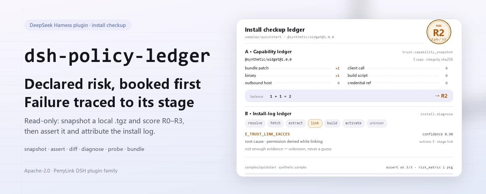
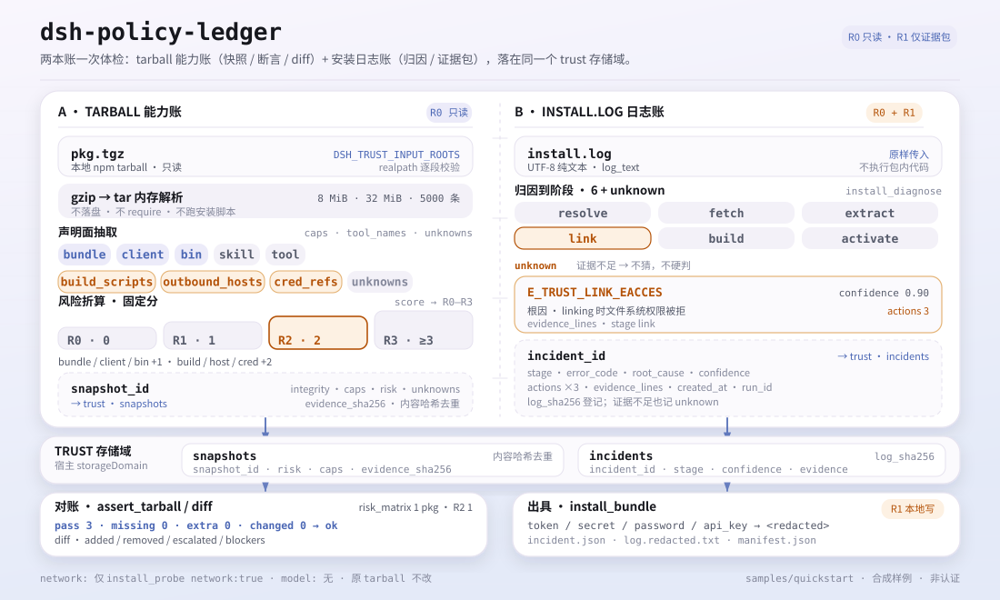
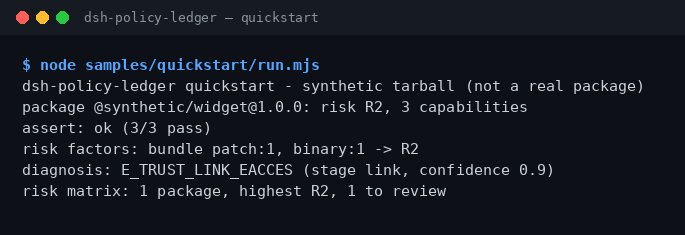

<div align="center">

<picture>
  <source media="(prefers-color-scheme: dark)" srcset="docs/assets/dsh-policy-ledger-hero-en-dark.webp">
  
</picture>

# dsh-policy-ledger

**Antes de instalar un paquete DSH de terceros, mira qué capacidades declara, qué nivel de riesgo tiene y por qué falló la instalación: solo lectura y sin tocar tu entorno.**

Un doctor de instalación de solo lectura para DeepSeek Harness: extrae las capacidades declaradas y el riesgo R0–R3 de un tarball npm local, contrasta el tarball con una instantánea guardada fila a fila y clasifica un log de instalación en etapa, causa raíz y tres acciones siguientes.

[Instalar](#instalación-en-tres-pasos) · [Configuración](#configuración) · [FAQ](#faq) · [简体中文](README.md) · [English](README.en.md) · [Español](README.es.md) · [Português](README.pt.md) · [हिन्दी](README.hi.md)

[](LICENSE)
[](#compatibilidad)
[](https://www.npmjs.com/package/dsh-policy-ledger)
[](https://github.com/PerryLink/dsh-policy-ledger/actions/workflows/ci.yml)
[](#compatibilidad)

[](https://github.com/PerryLink/dsh-policy-ledger/stargazers)
[](https://www.npmjs.com/package/dsh-policy-ledger)
[](https://dshfind.com/plugins/PerryLink/dsh-policy-ledger?ref=badge)
[](https://dsh.market/)
[](https://gitee.com/perrylink/dsh-policy-ledger)

```sh
dsh plugin --profile <profile> add dsh-policy-ledger
```

</div>

<sub>Plugin de la comunidad, no afiliado a DeepSeek. Repositorio canónico: <https://github.com/PerryLink/dsh-policy-ledger> (Gitee es un espejo).</sub>

> **Estado: alpha / sintético público / parcial / no contabilizado / no GA.** Sin evidencia de clientes, datos de clientes ni promesa de producción.

## Qué es

`dsh-policy-ledger` hace una revisión de solo lectura antes de instalar un paquete DSH de terceros: extrae lo que declara el `.tgz` npm local (herramientas, bundle/client/bin/skill, scripts de build, hosts de salida, referencias a credenciales) y lo convierte en un nivel de riesgo R0–R3 con reglas fijas. Cuando una instalación falla, clasifica el log en una de las etapas `resolve` / `fetch` / `extract` / `link` / `build` / `activate`, y devuelve la causa raíz y tres acciones siguientes. La entrada y la salida se quedan en tu máquina: sin llamadas al modelo, sin red por defecto, el tarball original no se modifica y no se ejecuta código del paquete. Responde «qué está instalado, qué contiene el tarball, por qué falló la instalación», no a comprobaciones de estructura de paquete, cableado de Cordis o sandbox smoke: eso corresponde al archivado `dsh-plugin-doctor`; usa ambos cuando necesites las dos respuestas.

<picture>
  <source media="(prefers-color-scheme: dark)" srcset="docs/assets/dsh-policy-ledger-flow-v5-dark.svg">
  
</picture>

*Figura: ambos libros comparten el dominio de almacenamiento trust; R0–R3 solo puntúa la superficie declarada, no es una certificación de seguridad.*

- **Adecuado para**: ver las capacidades y el riesgo declarados antes de instalar un paquete DSH de terceros; leer un log de instalación para saber dónde se detuvo; producir un paquete de incidente redactado que puedas reenviar.
- **No adecuado para**: ejecutar automáticamente un tarball, reparar una instalación o tomar por ti una decisión de permitir o bloquear; este paquete diagnostica en solo lectura y no es una puerta de políticas.

## Instalación en tres pasos

1. **Instala** (elige un canal):

   ```sh
   # canal npm (recomendado; versiones publicadas)
   dsh plugin --profile <profile> add dsh-policy-ledger
   # canal git (último main; equivale a git+https://github.com/PerryLink/dsh-policy-ledger.git)
   dsh plugin --profile <profile> add github:PerryLink/dsh-policy-ledger
   # canal tarball: tras pnpm pack en este repo
   dsh plugin --profile <profile> add ./dsh-policy-ledger-<version>.tgz
   ```

2. **Configuración mínima**: no hay claves de configuración: `cordis.patch.yml` solo hace `insert` de una fila y los valores por defecto bastan. Por defecto solo se pueden leer `.tgz` y logs de instalación bajo el directorio de trabajo del proceso host; para cambiarlo, define `DSH_TRUST_INPUT_ROOTS` (véase «Configuración»).

3. **Verifica que funciona**:

   ```sh
   dsh --profile <profile> --dump-config | grep dsh-policy-ledger
   node samples/quickstart/run.mjs
   ```

   El quickstart ejecuta instantánea de capacidades → aserción del tarball → desglose de riesgo → diagnóstico del log → matriz de riesgo de flota sobre el ejemplo sintético incluido, y lo compara con el patrón de oro `samples/quickstart/expected/result.json`. En el repositorio, ejecuta antes `pnpm build` para generar `lib/` (el paquete publicado ya incluye el build).

**Desinstalar**: `dsh plugin --profile <profile> remove dsh-policy-ledger` (o elimina la fila del patch del perfil).

<details>
<summary>Instalar desde el mercado de DSH Desktop</summary>

Todos los plugins de PerryLink están en el mercado integrado de DSH Desktop: **Mercado → Fuentes → Añadir fuente → pegar** `https://perrylink-dsh-catalog.perrylink.workers.dev/catalog-source.json` **→ seleccionar**. La instalación sigue requiriendo la verificación de identidad npm del mercado y tu confirmación.

</details>

## Capacidades clave

- **Instantánea de capacidades** — `trust_capability_snapshot` extrae de un `.tgz` npm local `name` / `version` / `integrity` / `risk` / `caps` / `tool_names` / `outbound_hosts` / `cred_refs` / `build_scripts` / `unknowns`; el análisis tar/gzip ocurre solo en memoria, no escribe en disco ni ejecuta código del paquete.
- **Desglose de riesgo** — bundle / client / bin suman 1 punto cada uno; los scripts de build / hosts de salida / referencias a credenciales suman 2 cada uno; un total de 0 / 1 / 2 / ≥3 corresponde a R0 / R1 / R2 / R3. `trust_risk_report` explica cada factor y `trust_risk_matrix` ofrece la vista de flota (recuento por nivel, nivel más alto y lista a revisar).
- **Comparación de instantáneas** — `trust_diff` compara dos instantáneas guardadas: capacidades añadidas o eliminadas, escalada de riesgo y bloqueadores como un nuevo script de build, una referencia a credenciales o un host de salida.
- **Aserción del tarball** — `trust_assert_tarball` relee un tarball y compara paquete, riesgo y capacidades fila a fila, con filas `pass` / `missing` / `extra` / `changed`; solo es `ok` si todas pasan y nunca trata una discrepancia como aprobada. `trust_assert` es un alias obsoleto con la misma semántica.
- **Diagnóstico del log de instalación** — `install_diagnose` asigna el log a `resolve` / `fetch` / `extract` / `link` / `build` / `activate` / `unknown` y devuelve `error_code`, `root_cause`, tres `actions` y `confidence`; si la evidencia no alcanza, devuelve unknown en vez de adivinar.
- **Sonda de entorno** — `install_probe` comprueba espacio libre, permiso de escritura, proxy, versiones de node/pnpm, y devuelve `clock_skew_ms` (actualmente fijo en 0); solo con `network: true` explícito hace un ping al registro con 5 segundos de timeout.
- **Paquete de incidente redactado** — `install_bundle` escribe un ZIP local (`incident.json` / `log.redacted.txt` / `manifest.json`): los valores de `token` / `secret` / `password` / `api_key` del log se sustituyen por `<redacted>` y el paquete incluye sha256 y el número de sustituciones; marcado R1 (escritura local).
- **Solo lectura y local** — sin llamadas al modelo, sin subidas y sin ninguna petición de red salvo el opt-in explícito de `install_probe`.

### Superficie de herramientas

Los nombres de herramientas son la API estable (se mantienen en inglés para coincidir con la salida del runtime; los segmentos se unen con guion bajo porque el proveedor valida `tools[].name` con `^[a-zA-Z0-9_-]+$`).

| Herramienta | Propósito | Riesgo |
|---|---|---|
| `trust_capability_snapshot` | Extrae las capacidades declaradas y el riesgo R0–R3 de un `.tgz` npm local: herramientas, bundle/client/bin/skill, scripts de build, hosts de salida y referencias a credenciales | R0 local read |
| `trust_diff` | Compara dos instantáneas guardadas: capacidades añadidas/eliminadas, escalada de riesgo y bloqueadores | R0 |
| `trust_assert_tarball` | Relee un tarball y lo compara con una instantánea guardada: pass/missing/extra/changed; una discrepancia nunca es un aprobado | R0 |
| `trust_assert` | Alias obsoleto de `trust_assert_tarball` (misma semántica) | R0 |
| `install_diagnose` | Clasifica un log de instalación en etapa, causa raíz y tres acciones; devuelve unknown en lugar de suponer | R0 |
| `install_probe` | Comprueba espacio libre, permiso de escritura, proxy, RTT de registro opcional, `clock_skew_ms` y node/pnpm | R0 |
| `install_bundle` | Escribe un ZIP de incidente redactado (diagnóstico + líneas de evidencia + hashes del manifest) | R1 local write |
| `trust_risk_report` | Desglosa la puntuación de riesgo: puntos por factor, total y veredicto R0–R3 | R0 |
| `trust_risk_matrix` | Vista de flota: recuento por R0–R3, nivel más alto y paquetes a revisar | R0 |

### Entrada y salida

Entrada:

- Un tarball npm local (`.tgz`, generado con `npm pack` / `pnpm pack`) que se resuelva bajo los directorios de `DSH_TRUST_INPUT_ROOTS` (por defecto, el directorio de trabajo).
- El log de instalación como texto UTF-8 sin transformar, pasado tal cual en `log_text`.
- El ejemplo incluido está en `samples/quickstart/input/`: un tarball sintético de 524 bytes y un log de instalación sintético, muy por debajo de 500 KB.
- Límites duros: 8 MiB por `.tgz`, 32 MiB descomprimido y 5000 entradas tar; al superarlos se lanza `E_TRUST_ARCHIVE_LIMIT` / `E_TRUST_TARBALL_LIMIT`.

Salida:

- Una instantánea de capacidades: `snapshot_id`, nombre/versión, integridad sha256, nivel de riesgo, lista de capacidades, nombres de herramientas, hosts de salida, referencias a credenciales, scripts de build y `unknowns`.
- Una aserción del tarball: filas `pass` / `missing` / `extra` / `changed` y un `ok` global; una discrepancia nunca se informa como aprobada.
- Un diagnóstico de instalación: `stage`, `error_code`, `root_cause`, tres `actions` y `confidence`; unknown cuando la evidencia no alcanza.
- Un paquete de incidente opcional en `$DSH_HOME/storages/dsh-policy-ledger/bundles/<incident>-<sha>.zip`; el log se redacta antes de escribirse y el tarball original no se modifica.

### Ejemplos

Copia este prompt tal cual (el prompt de demostración de `package.json`):

```text
帮我用自带样例做一次安装体检：这个包有什么能力、风险几级、装失败的那行日志是什么原因？
```

O ejecútalo tú mismo (ejecución real; la captura viene de este comando):

```sh
node samples/quickstart/run.mjs
```

```text
$ node samples/quickstart/run.mjs
dsh-policy-ledger quickstart - synthetic tarball (not a real package)
package @synthetic/widget@1.0.0: risk R2, 3 capabilities
assert: ok (3/3 pass)
risk factors: bundle patch:1, binary:1 -> R2
diagnosis: E_TRUST_LINK_EACCES (stage link, confidence 0.9)
risk matrix: 1 package, highest R2, 1 to review
```



*Tarball sintético → patrón de oro `samples/quickstart/expected/result.json`; comando y hashes en `screenshots.json`.*

Aceptación: `node scripts/acceptance.mjs` genera 3 tarballs sintéticos (safe / medium / risky) y 5 logs de instalación; [`ACCEPTANCE.csv`](ACCEPTANCE.csv) registra 7 comprobaciones públicas, todas `counted=false` salvo `PS1-QS01` (repetición del patrón de oro del quickstart, `counted=true`). Cobertura: instantánea de capacidades 3/3, captura de diff 1/1, diagnóstico de log 5/5, paquete de incidente 1/1, más las filas R3 de factores y matriz de riesgo.

*Estas son filas de aceptación respaldadas por fixtures/ejemplos, no ejecuciones de clientes; las columnas completas (incl. `script` y `evidence_sha256`) están en [`ACCEPTANCE.csv`](ACCEPTANCE.csv).*

## Configuración

Este plugin no tiene claves de configuración Schemastery: `cordis.patch.yml` solo hace `insert` de una fila (`id: dsh-policy-ledger`) y los valores por defecto bastan. Solo las variables de entorno son ajustables:

| Clave | Predeterminado | Significado |
|---|---|---|
| `DSH_TRUST_HOME` (variable de entorno) | `$DSH_HOME/storages/dsh-policy-ledger` | Raíz de `bundles/*.zip` y de la comprobación de escritura de `install_probe`; si `DSH_HOME` no está definido, cae a `storages/dsh-policy-ledger` bajo el cwd del proceso host |
| `DSH_TRUST_INPUT_ROOTS` (variable de entorno) | cwd del proceso host | Raíces de entrada permitidas; separa varios directorios con el delimitador de rutas de la plataforma (Windows `;`, POSIX `:`). Un `.tgz` o un log debe resolverse dentro de una de ellas o se lanza `E_TRUST_PATH_NOT_ALLOWED` |
| `DSH_HOME` (variable de entorno) | inyectado por el host | Raíz de almacenamiento cuando `DSH_TRUST_HOME` no está definido; las instantáneas y los incidentes persisten en el dominio `trust`, cuya ubicación gestiona el storageDomain del host |

<details>
<summary>Límites fijos y ubicaciones de escritura (ninguna clave de configuración los cambia)</summary>

| Elemento | Valor | Significado |
|---|---|---|
| Tamaño máximo de `.tgz` leído | 8 MiB | Se comprueba antes de leer; por encima se lanza `E_TRUST_ARCHIVE_LIMIT` |
| Tamaño máximo descomprimido | 32 MiB | La descompresión gzip se aborta en el límite, así que una gzip bomb no llega a materializarse |
| Entradas tar máximas | 5000 | Por encima se lanza `E_TRUST_TARBALL_LIMIT` |
| Instantáneas / incidentes | Dominio de almacenamiento `trust` (tablas `snapshots` / `incidents`) | Persistidos por el storageDomain del host; las instantáneas se deduplican por hash de contenido |
| Paquete de incidente | `<baseDir>/bundles/<incident>-<sha12>.zip` | `baseDir` es `DSH_TRUST_HOME`; contiene `incident.json` / `log.redacted.txt` / `manifest.json` |
| Tarball original | nunca se modifica ni se extrae a disco | El análisis ocurre solo en memoria |

</details>

## FAQ

<details>
<summary>La instalación falla, ¿y ahora qué?</summary>

Comprueba que DSH sea `>=0.2.1-rc.3 <0.4.0` y Node `>=24.9 <25`, y reintenta con un `DSH_HOME` nuevo; los pasos completos están en [`TROUBLESHOOTING.md`](TROUBLESHOOTING.md).

</details>

<details>
<summary>¿Por qué el paquete de ejemplo es R2 y no R0?</summary>

El riesgo es la suma de capacidades declaradas: bundle patch, client y bin suman 1 cada uno; scripts de build, hosts de salida y referencias a credenciales suman 2 cada uno; una puntuación de 2 es R2. El paquete de ejemplo declara bundle y bin, de ahí R2. El nivel es una puntuación basada en declaraciones, no una prueba de seguridad; revisa también `unknowns` y el código.

</details>

<details>
<summary>Recibí E_TRUST_PATH_NOT_ALLOWED, ¿qué hago?</summary>

Las herramientas solo leen archivos bajo `DSH_TRUST_INPUT_ROOTS`: la ruta se resuelve con `realpath` y se compara segmento a segmento con las raíces permitidas. Coloca el tarball dentro de uno de esos directorios o ejecuta DSH allí; no pases rutas como `/etc/hosts`. Usa el delimitador de rutas de la plataforma para varias raíces.

</details>

<details>
<summary>¿Usa la red? ¿Dónde se guardan los datos?</summary>

Por defecto no hay red, ni llamada al modelo, ni subida. Solo una llamada explícita a `install_probe` con `network: true` hace un ping a `registry.npmjs.org` con 5 segundos de timeout; el resultado no afecta a las demás herramientas. Las instantáneas e incidentes van al dominio `trust`, los paquetes de incidente a `bundles/` bajo `DSH_TRUST_HOME`, y el tarball original nunca se modifica.

</details>

<details>
<summary>¿Puede procesar mis paquetes npm reales? ¿El resultado es una certificación de seguridad?</summary>

Se ejecuta en local, pero el paquete es alpha y solo está validado con paquetes públicos/sintéticos: no es una certificación de seguridad ni una decisión de permiso. Para paquetes reales, revisa a mano el código, el publicador y los `unknowns`. Este paquete diagnostica en solo lectura y nunca bloquea una instalación.

</details>

<details>
<summary>El paquete es demasiado grande o supera el límite descomprimido, ¿qué hago?</summary>

Los límites son 8 MiB por `.tgz`, 32 MiB descomprimido y 5000 entradas tar; al superarlos se lanza `E_TRUST_ARCHIVE_LIMIT` / `E_TRUST_TARBALL_LIMIT`. Usa un paquete oficial más pequeño o revísalo a mano primero; no subas los límites solo para conseguir una instalación.

</details>

## Límites de seguridad

- **Solo lectura por defecto.** Todas las herramientas son R0 salvo `install_bundle` (R1, escritura local); no hay instalación, reparación, ejecución ni rollback automáticos.
- **Alcance de lectura controlado.** Solo se leen el `.tgz` y el texto del log que pasas bajo `DSH_TRUST_INPUT_ROOTS`; las rutas se resuelven con `realpath` y se comparan segmento a segmento, así que lo que quede fuera lanza `E_TRUST_PATH_NOT_ALLOWED`.
- **No se ejecuta código del paquete.** tar/gzip se analiza en memoria: nada se extrae a disco, no se hace `require` de módulos del paquete y los scripts `preinstall` / `postinstall` nunca se ejecutan.
- **Alcance de escritura controlado.** Solo se escriben el dominio `trust` (instantáneas/incidentes) y `bundles/*.zip` bajo `DSH_TRUST_HOME`; el tarball original y los datos de otros plugins no se tocan.
- **Superficie de red mínima.** Solo `install_probe` con `network: true` contacta `registry.npmjs.org` para un ping de 5 segundos; sin llamadas al modelo y sin subir paquetes de incidente.
- **Fallo cerrado, nunca adivinar.** Entrada sobredimensionada, gzip inválido, falta de `package/package.json`, instantánea desconocida o evidencia insuficiente producen un código de error explícito o `unknown`, nunca un aprobado silencioso.
- **Redactar antes de escribir.** Antes de escribir un paquete de incidente, los valores de `token` / `secret` / `password` / `api_key` se sustituyen por `<redacted>` y el recuento se registra en el manifest.

## Limitaciones conocidas

- **Solo validación pública/sintética.** alpha / parcial / no contabilizado / no GA; 0 perfiles de agente reales y 0 entrevistas de TI, sin datos ni evidencia de clientes, y sin promesa de producción.
- **El riesgo es una puntuación basada en declaraciones.** R0–R3 solo refleja lo que el paquete declara (bundle / client / bin / scripts de build / hosts de salida / referencias a credenciales), no su comportamiento real; los `unknowns` requieren revisión humana.
- **Solo tarballs npm.** La entrada debe ser un `.tgz`; no se escanean `node_modules` instalados, paquetes en directorio ni lockfiles.
- **El diagnóstico del log es por patrones.** Cubre las ramas 404, EACCES, red, ENOSPC, conflicto de peer, script de build, integridad y activate; si la evidencia no alcanza, devuelve unknown en lugar de adivinar.
- **Límites duros de entrada.** 8 MiB empaquetado / 32 MiB descomprimido / 5000 entradas; los paquetes grandes deben revisarse a mano antes.
- **Las rutas están confinadas a las raíces de entrada.** Es una frontera de seguridad, no un bug; leer fuera requiere configurar `DSH_TRUST_INPUT_ROOTS`.
- **No es una puerta de políticas.** No hay `install_retry`, ni Gate/ledger, ni mitad de cliente, ni raíz de firma; no repara ni bloquea instalaciones.
- **La redacción del paquete es a nivel de regex.** Revísalo antes de compartirlo; este paquete no promete reconocer todos los formatos de secretos.
- **`trust_assert` está obsoleto.** El código nuevo debe usar `trust_assert_tarball`; la semántica es idéntica.

## Interoperabilidad con otros plugins DSH

- **Sin solapamiento con `dsh-plugin-doctor`.** El archivado `dsh-plugin-doctor` hacía comprobaciones de estructura de paquete, cableado de Cordis y sandbox smoke; este paquete hace instantáneas de capacidades, aserciones de tarball y diagnóstico de logs. Usa ambos cuando necesites las dos respuestas.
- **Sin colisión de nombres de herramienta.** Todas las herramientas están bajo los espacios `trust_*` / `install_*`; no se registra ningún nombre desnudo de una herramienta incluida o de otro plugin.
- **Sin colisión de clave de servicio, slot ni ruta HTTP.** No registra clave de servicio, ni slot de cliente, ni prefijo `webServer`; `cordis.patch.yml` solo hace `insert` de su propia fila y nunca sobrescribe una fila incluida.
- **Almacenamiento y globales aislados.** Solo abre su propio dominio `trust` y escribe solo su propio `bundles/`; no parchea prototipos, no reescribe `process.env` ni reemplaza el dispatcher global de fetch.

## Compatibilidad

| Superficie | Estado |
|---|---|
| Harness | `dsh >=0.2.1-rc.3 <0.4.0` |
| Node | `>=24.9.0 <25` |
| Plataformas | Donde corra DSH; solo archivos locales |
| Datos | Sin red, sin llamada al modelo y sin subida por defecto; solo `install_probe` con `network: true` hace ping al registro |

## Ecosistema y calidad

- [Espejo de Gitee](https://gitee.com/perrylink/dsh-policy-ledger) (espejo sincronizado; GitHub es el canónico)
- [Página del plugin en dshfind](https://dshfind.com/plugins/PerryLink/dsh-policy-ledger) (instalaciones y ranking)
- [DSH Market](https://dsh.market/) (listado)
- **Canal de la tienda 1024**: `npm i -g dsh1024` una vez y luego `dsh1024 plugin --profile <profile> add dsh-policy-ledger` (cuenta para el ranking de instalaciones de [deepseek1024.com](https://deepseek1024.com))
- Documentación: [`TROUBLESHOOTING.md`](TROUBLESHOOTING.md) · [`PRIVACY.md`](PRIVACY.md) · [`SECURITY.md`](SECURITY.md) · [`EVIDENCE.md`](EVIDENCE.md) · [Índice de dominio](https://perrylink.github.io/dsh-plugins/) · [Familia de checkers](https://perrylink.github.io/zh/checkers/)
- Paquetes hermanos: [dsh-pim-lint](https://github.com/PerryLink/dsh-pim-lint) · [dsh-eval-pack](https://github.com/PerryLink/dsh-eval-pack)

## Desarrollo

```sh
pnpm install --frozen-lockfile
pnpm build && pnpm lint && pnpm typecheck && pnpm test   # build tsc + node --test test/*.test.mjs
node scripts/acceptance.mjs                              # aceptación (7 filas), detalle en ACCEPTANCE.csv
pnpm run pack:check                                      # comprobación dry-run del contenido publicado
node samples/quickstart/run.mjs --check                  # compara el ejemplo sintético con el patrón de oro
dsh-policy-ledger doctor <package.tgz> --json            # instantánea de capacidades por CLI (código de salida 2 para R3)
```

| Ruta | Contenido |
|---|---|
| `src/core/` | Puntuación de riesgo, diff, diagnóstico de logs, matriz de riesgo (funciones puras, sin dependencia de DSH) |
| `src/adapters/` | Análisis tar/gzip y extracción de capacidades (límites de memoria, nada se escribe en disco) |
| `src/plugin/` | Cara host de Cordis: registro de herramientas, dominio `trust`, escritura de paquetes de incidente |
| `bin/` | CLI `dsh-policy-ledger doctor <pkg.tgz> [--json]` |
| `test/` | `node --test` (tras el build) |
| `samples/quickstart/` | Tarball sintético + log de instalación + patrón de oro |
| `scripts/` | Aceptación, comprobaciones de empaquetado, generación de recursos |
| `evidence/` | `result.json` de cada ejecución de aceptación (local, no se publica) |

Los fuentes TypeScript están en `src/` y el build en `lib/`. El hero y el diagrama de estructura los genera programáticamente [`scripts/gen-readme-assets.py`](scripts/gen-readme-assets.py) (Python 3 + Pillow para el hero WebP; el SVG se escribe a mano; salidas `docs/assets/dsh-policy-ledger-hero-{zh,en}-{light,dark}.webp` y `dsh-policy-ledger-flow-v5-{light,dark}.svg`) y se pueden reejecutar sin riesgo.

Topics: `deepseek-harness`, `dsh`, `dsh-plugin`, `trust`, `install-doctor`, `capability-snapshot`, `perrylink`, `security`

## Familia y agradecimientos

Este proyecto forma parte de la familia de plugins de DeepSeek Harness de [PerryLink](https://github.com/PerryLink) (todos Apache-2.0). Si te resulta útil, **una estrella ayuda a que la siguiente persona lo encuentre** — no hay nada bloqueado tras ella.

- [@PerryLink](https://github.com/PerryLink) — creador y mantenedor: extracción de capacidades del tarball, puntuación de riesgo R0–R3, aserción y diff de instantáneas, diagnóstico de logs de instalación, paquete de incidente redactado y documentación en cinco idiomas.

## Licencia

[LICENSE](LICENSE) (Apache License 2.0) © 2026 dsh-policy-ledger contributors; véase también `NOTICE` y `THIRD-PARTY-NOTICES`.

<p align="center"><sub>Apache-2.0 · Plugin de la comunidad, no afiliado a DeepSeek.</sub></p>
