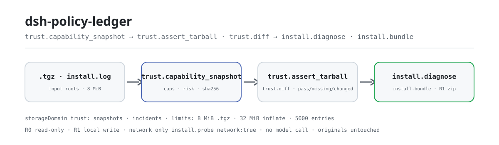

<div align="center">

<picture>
  <source media="(prefers-color-scheme: dark)" srcset="docs/assets/dsh-policy-ledger-flow-dark.svg">
  
</picture>

# dsh-policy-ledger

**किसी तृतीय-पक्ष DSH पैकेज को इंस्टॉल करने से पहले देखें कि वह कौन-सी क्षमताएँ घोषित करता है, जोखिम कितना है और इंस्टॉल क्यों विफल हुआ — केवल-पठन, आपके परिवेश में कुछ नहीं बदलता।**

DeepSeek Harness के लिए एक केवल-पठन इंस्टॉल डॉक्टर: स्थानीय npm tarball से घोषित क्षमताएँ और R0–R3 जोखिम निकालता है, tarball की संग्रहीत स्नैपशॉट से पंक्ति-दर-पंक्ति जाँच करता है, और इंस्टॉल लॉग को चरण, मूल कारण और तीन अगली कार्रवाइयों में वर्गीकृत करता है।

[इंस्टॉल](#तीन-चरणों-में-शुरुआत) · [कॉन्फ़िगरेशन](#कॉन्फ़िगरेशन) · [FAQ](#faq) · [简体中文](README.md) · [English](README.en.md) · [Español](README.es.md) · [Português](README.pt.md) · [हिन्दी](README.hi.md)

[](LICENSE)
[](#संगतता)
[](https://www.npmjs.com/package/dsh-policy-ledger)
[](https://github.com/PerryLink/dsh-policy-ledger/actions/workflows/ci.yml)
[](#संगतता)

[](https://github.com/PerryLink/dsh-policy-ledger/stargazers)
[](https://www.npmjs.com/package/dsh-policy-ledger)
[](https://dshfind.com/plugins/PerryLink/dsh-policy-ledger?ref=badge)
[](https://dsh.market/)
[](https://gitee.com/perrylink/dsh-policy-ledger)

```sh
dsh plugin --profile <profile> add dsh-policy-ledger
```

</div>

<sub>सामुदायिक प्लगइन, DeepSeek से संबद्ध नहीं। आधिकारिक रिपॉज़िटरी: <https://github.com/PerryLink/dsh-policy-ledger> (Gitee एक मिरर है)।</sub>

> **स्थिति: alpha / सार्वजनिक-सिंथेटिक / आंशिक / गिना नहीं गया / GA नहीं।** ग्राहक साक्ष्य, ग्राहक डेटा या उत्पादन-तैयारी का दावा नहीं।

## यह क्या है

`dsh-policy-ledger` किसी तृतीय-पक्ष DSH पैकेज को इंस्टॉल करने से पहले केवल-पठन जाँच करता है: स्थानीय npm `.tgz` में घोषित चीज़ें (टूल, bundle/client/bin/skill, बिल्ड स्क्रिप्ट, आउटबाउंड होस्ट, क्रेडेंशियल संदर्भ) निकालता है और निश्चित नियमों से उन्हें R0–R3 जोखिम में बदलता है। इंस्टॉल विफल होने पर लॉग को `resolve` / `fetch` / `extract` / `link` / `build` / `activate` में से किसी एक चरण में वर्गीकृत करता है और मूल कारण तथा तीन अगली कार्रवाइयाँ देता है। इनपुट और आउटपुट आपकी मशीन पर ही रहते हैं: कोई मॉडल कॉल नहीं, डिफ़ॉल्ट रूप से कोई नेटवर्क नहीं, मूल tarball अपरिवर्तित रहता है और पैकेज का कोई कोड नहीं चलता। यह «क्या इंस्टॉल है, tarball में क्या है, इंस्टॉल क्यों विफल हुआ» का उत्तर देता है, पैकेज-संरचना, Cordis वायरिंग या sandbox smoke जाँच का नहीं — वे आर्काइव किए गए `dsh-plugin-doctor` का काम हैं; दोनों उत्तर चाहिए तो दोनों इस्तेमाल करें।

- **किसके लिए उपयुक्त**: तृतीय-पक्ष DSH पैकेज इंस्टॉल करने से पहले घोषित क्षमताएँ और जोखिम देखना; इंस्टॉल लॉग पढ़कर पता लगाना कि कहाँ रुका; आगे भेजने योग्य redacted incident बंडल बनाना।
- **किसके लिए नहीं**: tarball को स्वचालित रूप से चलाना, इंस्टॉल की मरम्मत करना, या आपके लिए allow/block निर्णय लेना; यह पैकेज केवल-पठन निदान करता है और नीति-गेट नहीं है।

## तीन चरणों में शुरुआत

1. **इंस्टॉल** (कोई एक चैनल चुनें):

   ```sh
   # npm चैनल (अनुशंसित; प्रकाशित संस्करण)
   dsh plugin --profile <profile> add dsh-policy-ledger
   # git चैनल (नवीनतम main; git+https://github.com/PerryLink/dsh-policy-ledger.git के बराबर)
   dsh plugin --profile <profile> add github:PerryLink/dsh-policy-ledger
   # tarball चैनल: इस रेपो में pnpm pack के बाद
   dsh plugin --profile <profile> add ./dsh-policy-ledger-<version>.tgz
   ```

2. **न्यूनतम कॉन्फ़िगरेशन**: कोई कॉन्फ़िगरेशन कुंजी नहीं है — `cordis.patch.yml` केवल एक पंक्ति `insert` करता है और डिफ़ॉल्ट ही पर्याप्त हैं। डिफ़ॉल्ट रूप से होस्ट प्रोसेस के कार्यशील निर्देशिका के अंतर्गत केवल `.tgz` और इंस्टॉल लॉग पढ़े जा सकते हैं; बदलने के लिए `DSH_TRUST_INPUT_ROOTS` सेट करें (देखें «कॉन्फ़िगरेशन»)।

3. **जाँचें कि काम करता है**:

   ```sh
   dsh --profile <profile> --dump-config | grep dsh-policy-ledger
   node samples/quickstart/run.mjs
   ```

   quickstart संलग्न सिंथेटिक नमूने पर क्षमता स्नैपशॉट → tarball जाँच → जोखिम विश्लेषण → इंस्टॉल लॉग निदान → फ्लीट जोखिम मैट्रिक्स चलाता है और स्वर्ण मानक `samples/quickstart/expected/result.json` से तुलना करता है। रेपो में पहले `pnpm build` चलाएँ ताकि `lib/` बने (प्रकाशित पैकेज में बिल्ड पहले से है)।

**अनइंस्टॉल**: `dsh plugin --profile <profile> remove dsh-policy-ledger` (या प्रोफ़ाइल पैच से वह पंक्ति हटाएँ)।

<details>
<summary>DSH Desktop मार्केट से इंस्टॉल करें</summary>

सभी PerryLink प्लगइन DSH Desktop के अंतर्निहित मार्केट में मिलते हैं: **मार्केट → स्रोत → स्रोत जोड़ें → चिपकाएँ** `https://perrylink-dsh-catalog.perrylink.workers.dev/catalog-source.json` **→ चुनें**। इंस्टॉल के लिए मार्केट की npm पहचान जाँच और आपकी पुष्टि अभी भी आवश्यक है।

</details>

## मुख्य क्षमताएँ

- **क्षमता स्नैपशॉट** — `trust.capability_snapshot` स्थानीय npm `.tgz` से `name` / `version` / `integrity` / `risk` / `caps` / `tool_names` / `outbound_hosts` / `cred_refs` / `build_scripts` / `unknowns` निकालता है; tar/gzip विश्लेषण केवल मेमोरी में होता है, डिस्क पर कुछ नहीं लिखता और पैकेज का कोड नहीं चलाता।
- **जोखिम विश्लेषण** — bundle / client / bin में से प्रत्येक 1 अंक; बिल्ड स्क्रिप्ट / आउटबाउंड होस्ट / क्रेडेंशियल संदर्भ में से प्रत्येक 2 अंक; कुल 0 / 1 / 2 / ≥3 क्रमशः R0 / R1 / R2 / R3 है। `trust.risk_report` हर कारक समझाता है और `trust.risk_matrix` फ्लीट दृश्य देता है (प्रति स्तर गणना, उच्चतम स्तर, समीक्षा सूची)।
- **स्नैपशॉट तुलना** — `trust.diff` दो संग्रहीत स्नैपशॉट की तुलना करता है: जोड़ी गई/हटाई गई क्षमताएँ, जोखिम वृद्धि, और नई बिल्ड स्क्रिप्ट, क्रेडेंशियल संदर्भ या आउटबाउंड होस्ट जैसे अवरोधक।
- **tarball जाँच** — `trust.assert_tarball` tarball को फिर पढ़कर पैकेज, जोखिम और क्षमताओं की स्नैपशॉट से पंक्ति-दर-पंक्ति तुलना करता है और `pass` / `missing` / `extra` / `changed` पंक्तियाँ देता है; केवल सभी `pass` होने पर `ok` होता है और असंगति को कभी पास नहीं माना जाता। `trust.assert` उसी अर्थ वाला अप्रचलित उपनाम है।
- **इंस्टॉल लॉग निदान** — `install.diagnose` लॉग को `resolve` / `fetch` / `extract` / `link` / `build` / `activate` / `unknown` में मैप करता है और `error_code`, `root_cause`, तीन `actions` तथा `confidence` लौटाता है; साक्ष्य अपर्याप्त होने पर अनुमान के बजाय unknown देता है।
- **परिवेश जाँच** — `install.probe` डिस्क खाली स्थान, लेखन अनुमति, प्रॉक्सी, node/pnpm संस्करण, और `clock_skew_ms` लौटाता है (अभी 0 पर स्थिर); केवल स्पष्ट `network: true` पर 5 सेकंड टाइमआउट के साथ registry को एक ping करता है।
- **Redacted incident बंडल** — `install.bundle` स्थानीय ZIP लिखता है (`incident.json` / `log.redacted.txt` / `manifest.json`): लॉग में `token` / `secret` / `password` / `api_key` के मान `<redacted>` से बदल दिए जाते हैं और बंडल में sha256 तथा redaction गणना रहती है; R1 (स्थानीय लेखन) चिह्नित।
- **केवल-पठन और स्थानीय** — कोई मॉडल कॉल नहीं, कोई अपलोड नहीं, और `install.probe` के स्पष्ट opt-in के अलावा कोई नेटवर्क अनुरोध नहीं।

### टूल सतह

टूल नाम स्थिर API हैं (रनटाइम आउटपुट से मेल खाने के लिए अंग्रेज़ी में रखे गए हैं)।

| टूल | उद्देश्य | जोखिम |
|---|---|---|
| `trust.capability_snapshot` | स्थानीय npm `.tgz` से घोषित क्षमताएँ और R0–R3 जोखिम निकालता है: टूल, bundle/client/bin/skill, बिल्ड स्क्रिप्ट, आउटबाउंड होस्ट, क्रेडेंशियल संदर्भ | R0 local read |
| `trust.diff` | दो संग्रहीत स्नैपशॉट की तुलना: जोड़ी गई/हटाई गई क्षमताएँ, जोखिम वृद्धि, अवरोधक | R0 |
| `trust.assert_tarball` | tarball को फिर पढ़कर स्नैपशॉट से तुलना: pass/missing/extra/changed; असंगति कभी पास नहीं | R0 |
| `trust.assert` | `trust.assert_tarball` का अप्रचलित उपनाम (समान अर्थ) | R0 |
| `install.diagnose` | इंस्टॉल लॉग को चरण, मूल कारण और तीन कार्रवाइयों में वर्गीकृत करता है; अनुमान के बजाय unknown | R0 |
| `install.probe` | डिस्क स्थान, लेखन अनुमति, प्रॉक्सी, वैकल्पिक registry RTT, `clock_skew_ms` और node/pnpm जाँचता है | R0 |
| `install.bundle` | redacted incident ZIP लिखता है (निदान + साक्ष्य पंक्तियाँ + manifest हैश) | R1 local write |
| `trust.risk_report` | जोखिम स्कोर समझाता है: प्रति कारक अंक, कुल और R0–R3 निष्कर्ष | R0 |
| `trust.risk_matrix` | फ्लीट दृश्य: R0–R3 गणना, उच्चतम स्तर और समीक्षा योग्य पैकेज | R0 |

### इनपुट और आउटपुट

इनपुट:

- स्थानीय npm tarball (`.tgz`, `npm pack` / `pnpm pack` से बना) जो `DSH_TRUST_INPUT_ROOTS` की निर्देशिकाओं (डिफ़ॉल्ट: कार्यशील निर्देशिका) के अंतर्गत हल हो।
- इंस्टॉल लॉग सादा UTF-8 टेक्स्ट के रूप में, बिना बदले `log_text` में दिया गया।
- संलग्न नमूना `samples/quickstart/input/` में है: 524 बाइट का सिंथेटिक tarball और एक सिंथेटिक इंस्टॉल लॉग, 500 KB से बहुत कम।
- कठोर सीमाएँ: प्रति `.tgz` 8 MiB, विस्तारित 32 MiB और 5000 tar प्रविष्टियाँ; पार करने पर `E_TRUST_ARCHIVE_LIMIT` / `E_TRUST_TARBALL_LIMIT`।

आउटपुट:

- क्षमता स्नैपशॉट: `snapshot_id`, नाम/संस्करण, sha256 अखंडता, जोखिम स्तर, क्षमता सूची, टूल नाम, आउटबाउंड होस्ट, क्रेडेंशियल संदर्भ, बिल्ड स्क्रिप्ट और `unknowns`।
- tarball जाँच: `pass` / `missing` / `extra` / `changed` पंक्तियाँ और समग्र `ok`; असंगति कभी पास के रूप में नहीं बताई जाती।
- इंस्टॉल निदान: `stage`, `error_code`, `root_cause`, तीन `actions` और `confidence`; साक्ष्य अपर्याप्त होने पर unknown।
- वैकल्पिक incident बंडल `$DSH_HOME/storages/dsh-policy-ledger/bundles/<incident>-<sha>.zip` पर; लॉग लिखने से पहले redact होता है और मूल tarball अपरिवर्तित रहता है।

### उदाहरण

यह प्रॉम्प्ट जैसा है वैसा कॉपी करें (`package.json` का डेमो प्रॉम्प्ट):

```text
帮我用自带样例做一次安装体检：这个包有什么能力、风险几级、装失败的那行日志是什么原因？
```

या स्वयं चलाएँ (वास्तविक रन; स्क्रीनशॉट इसी कमांड से है):

```sh
node samples/quickstart/run.mjs
```

```text
$ node samples/quickstart/run.mjs
dsh-policy-ledger quickstart - synthetic tarball (not a real package)
package @synthetic/widget@1.0.0: risk R2, 3 capabilities
assert: ok (3/3 pass)
risk factors: bundle patch:1, binary:1 -> R2
diagnosis: E_TRUST_LINK_EACCES (stage link, confidence 0.9)
risk matrix: 1 package, highest R2, 1 to review
```


*सिंथेटिक tarball → स्वर्ण मानक `samples/quickstart/expected/result.json`; कमांड और हैश `screenshots.json` में।*

स्वीकृति: `node scripts/acceptance.mjs` 3 सिंथेटिक tarball (safe / medium / risky) और 5 इंस्टॉल लॉग बनाता है; [`ACCEPTANCE.csv`](ACCEPTANCE.csv) 7 सार्वजनिक जाँचें दर्ज करता है, `PS1-QS01` (quickstart स्वर्ण-मानक पुनरावृत्ति, `counted=true`) को छोड़कर सभी `counted=false`। कवरेज: क्षमता स्नैपशॉट 3/3, diff कैप्चर 1/1, इंस्टॉल लॉग निदान 5/5, incident बंडल 1/1, साथ ही जोखिम कारक और मैट्रिक्स की R3 पंक्तियाँ।

*ये fixture/नमूना-आधारित स्वीकृति पंक्तियाँ हैं, ग्राहक रन नहीं; पूर्ण कॉलम (`script` और `evidence_sha256` सहित) [`ACCEPTANCE.csv`](ACCEPTANCE.csv) में हैं।*

## कॉन्फ़िगरेशन

इस प्लगइन में कोई Schemastery कॉन्फ़िगरेशन कुंजी नहीं है: `cordis.patch.yml` केवल एक पंक्ति `insert` करता है (`id: dsh-policy-ledger`) और डिफ़ॉल्ट ही पर्याप्त हैं। केवल पर्यावरण चर समायोज्य हैं:

| कुंजी | डिफ़ॉल्ट | अर्थ |
|---|---|---|
| `DSH_TRUST_HOME` (पर्यावरण चर) | `$DSH_HOME/storages/dsh-policy-ledger` | `bundles/*.zip` और `install.probe` की लेखन-जाँच का मूल; `DSH_HOME` न होने पर होस्ट प्रोसेस cwd के तहत `storages/dsh-policy-ledger` पर वापस जाता है |
| `DSH_TRUST_INPUT_ROOTS` (पर्यावरण चर) | होस्ट प्रोसेस cwd | अनुमत इनपुट मूल; कई निर्देशिकाओं को प्लेटफ़ॉर्म पथ विभाजक (Windows `;`, POSIX `:`) से अलग करें। `.tgz` या लॉग इनमें से किसी के अंदर हल होना चाहिए, अन्यथा `E_TRUST_PATH_NOT_ALLOWED` |
| `DSH_HOME` (पर्यावरण चर) | होस्ट द्वारा इंजेक्ट | `DSH_TRUST_HOME` न होने पर स्टोरेज मूल; स्नैपशॉट और incident `trust` स्टोरेज डोमेन में रहते हैं, जिसका स्थान होस्ट का storageDomain प्रबंधित करता है |

<details>
<summary>निश्चित सीमाएँ और लेखन स्थान (कोई कॉन्फ़िगरेशन कुंजी इन्हें नहीं बदलती)</summary>

| मद | मान | अर्थ |
|---|---|---|
| पढ़े जाने वाले `.tgz` का अधिकतम आकार | 8 MiB | पढ़ने से पहले जाँचा जाता है; अधिक होने पर `E_TRUST_ARCHIVE_LIMIT` |
| अधिकतम विस्तारित आकार | 32 MiB | gzip विस्तार सीमा पर रुक जाता है, इसलिए gzip bomb पूरी तरह नहीं बनती |
| अधिकतम tar प्रविष्टियाँ | 5000 | अधिक होने पर `E_TRUST_TARBALL_LIMIT` |
| स्नैपशॉट / incident | `trust` स्टोरेज डोमेन (`snapshots` / `incidents` तालिकाएँ) | होस्ट storageDomain द्वारा संग्रहीत; स्नैपशॉट सामग्री-हैश से deduplicate होते हैं |
| incident बंडल | `<baseDir>/bundles/<incident>-<sha12>.zip` | `baseDir` यानी `DSH_TRUST_HOME`; इसमें `incident.json` / `log.redacted.txt` / `manifest.json` |
| मूल tarball | कभी नहीं बदला जाता, डिस्क पर extract नहीं होता | विश्लेषण केवल मेमोरी में |

</details>

## FAQ

<details>
<summary>इंस्टॉल विफल हो जाए तो क्या करें?</summary>

जाँचें कि DSH `>=0.2.1-rc.3 <0.4.0` और Node `>=24.9 <25` है, फिर नए `DSH_HOME` के साथ पुनः प्रयास करें; पूरे चरण [`TROUBLESHOOTING.md`](TROUBLESHOOTING.md) में हैं।

</details>

<details>
<summary>नमूना पैकेज R0 के बजाय R2 क्यों है?</summary>

जोखिम घोषित क्षमताओं का योग है: bundle patch, client और bin प्रत्येक 1 अंक; बिल्ड स्क्रिप्ट, आउटबाउंड होस्ट और क्रेडेंशियल संदर्भ प्रत्येक 2 अंक; स्कोर 2 यानी R2। नमूना पैकेज bundle और bin दोनों घोषित करता है, इसलिए R2। स्तर घोषणा-आधारित स्कोर है, सुरक्षा का प्रमाण नहीं; `unknowns` और स्रोत भी देखें।

</details>

<details>
<summary>E_TRUST_PATH_NOT_ALLOWED मिला — क्या करें?</summary>

टूल केवल `DSH_TRUST_INPUT_ROOTS` के अंतर्गत फ़ाइलें पढ़ते हैं: पथ `realpath` से हल होकर अनुमत मूलों से खंड-दर-खंड तुलना होता है। tarball को उन्हीं निर्देशिकाओं में रखें या वहीं DSH चलाएँ; `/etc/hosts` जैसे पथ न दें। कई मूलों के लिए प्लेटफ़ॉर्म पथ विभाजक इस्तेमाल करें।

</details>

<details>
<summary>क्या यह नेटवर्क इस्तेमाल करता है? डेटा कहाँ रहता है?</summary>

डिफ़ॉल्ट रूप से कोई नेटवर्क, मॉडल कॉल या अपलोड नहीं। केवल स्पष्ट `install.probe` कॉल में `network: true` होने पर `registry.npmjs.org` को 5 सेकंड टाइमआउट के साथ एक ping होता है; परिणाम अन्य टूल को प्रभावित नहीं करता। स्नैपशॉट और incident `trust` डोमेन में, incident बंडल `DSH_TRUST_HOME` के तहत `bundles/` में जाते हैं, और मूल tarball कभी नहीं बदलता।

</details>

<details>
<summary>क्या यह मेरे वास्तविक npm पैकेज संभाल सकता है? परिणाम सुरक्षा प्रमाणन है?</summary>

यह स्थानीय रूप से चलता है, लेकिन पैकेज alpha है और केवल सार्वजनिक/सिंथेटिक पैकेजों पर सत्यापित है — यह सुरक्षा प्रमाणन या allow निर्णय नहीं है। वास्तविक पैकेजों के लिए स्रोत, प्रकाशक और `unknowns` की मानवीय समीक्षा करें। यह पैकेज केवल-पठन निदान करता है और कभी इंस्टॉल नहीं रोकता।

</details>

<details>
<summary>पैकेज बहुत बड़ा है या विस्तारित सीमा पार करता है — क्या करें?</summary>

सीमाएँ हैं प्रति `.tgz` 8 MiB, विस्तारित 32 MiB और 5000 tar प्रविष्टियाँ; पार करने पर `E_TRUST_ARCHIVE_LIMIT` / `E_TRUST_TARBALL_LIMIT`। छोटा आधिकारिक पैकेज इस्तेमाल करें, या पहले मानवीय जाँच करें; सिर्फ़ इंस्टॉल निकालने के लिए सीमाएँ न बढ़ाएँ।

</details>

## सुरक्षा सीमाएँ

- **डिफ़ॉल्ट रूप से केवल-पठन।** `install.bundle` (R1, स्थानीय लेखन) को छोड़कर सभी टूल R0 हैं; कोई स्वचालित इंस्टॉल, मरम्मत, निष्पादन या rollback नहीं।
- **नियंत्रित पठन दायरा।** केवल वही `.tgz` और लॉग टेक्स्ट पढ़ा जाता है जो आप `DSH_TRUST_INPUT_ROOTS` के अंतर्गत देते हैं; पथ `realpath` से हल होकर खंड-दर-खंड तुलना होते हैं, इसलिए बाहर की कोई चीज़ `E_TRUST_PATH_NOT_ALLOWED` देती है।
- **पैकेज का कोड नहीं चलता।** tar/gzip मेमोरी में पढ़ा जाता है — डिस्क पर कुछ extract नहीं होता, पैकेज के किसी मॉड्यूल का `require` नहीं होता और `preinstall` / `postinstall` स्क्रिप्ट कभी नहीं चलतीं।
- **नियंत्रित लेखन दायरा।** केवल `trust` डोमेन (स्नैपशॉट/incident) और `DSH_TRUST_HOME` के तहत `bundles/*.zip` लिखे जाते हैं; मूल tarball और अन्य प्लगइन का डेटा अछूता रहता है।
- **न्यूनतम नेटवर्क सतह।** केवल `install.probe` में `network: true` होने पर `registry.npmjs.org` से 5 सेकंड का एक ping; कोई मॉडल कॉल नहीं और incident बंडल का कोई अपलोड नहीं।
- **विफलता-बंद, कभी अनुमान नहीं।** बहुत बड़ा इनपुट, अमान्य gzip, `package/package.json` की कमी, अज्ञात स्नैपशॉट या अपर्याप्त साक्ष्य स्पष्ट त्रुटि कोड या `unknown` देते हैं — कभी मौन पास नहीं।
- **लिखने से पहले redact।** incident बंडल लिखने से पहले `token` / `secret` / `password` / `api_key` के मान `<redacted>` से बदले जाते हैं और गणना manifest में दर्ज होती है।

## ज्ञात सीमाएँ

- **केवल सार्वजनिक/सिंथेटिक सत्यापन।** alpha / आंशिक / गिना नहीं गया / GA नहीं; 0 वास्तविक agent प्रोफ़ाइल और 0 IT साक्षात्कार, कोई ग्राहक डेटा या साक्ष्य नहीं, और उत्पादन-तैयारी का दावा नहीं।
- **जोखिम घोषणा-आधारित स्कोर है।** R0–R3 केवल वही दर्शाता है जो पैकेज घोषित करता है (bundle / client / bin / बिल्ड स्क्रिप्ट / आउटबाउंड होस्ट / क्रेडेंशियल संदर्भ), उसका वास्तविक व्यवहार नहीं; `unknowns` की मानवीय समीक्षा ज़रूरी है।
- **केवल npm tarball।** इनपुट `.tgz` होना चाहिए; इंस्टॉल किए गए `node_modules`, निर्देशिका-रूप पैकेज या lockfile स्कैन नहीं होते।
- **लॉग निदान पैटर्न-आधारित है।** 404, EACCES, नेटवर्क, ENOSPC, peer-निर्भरता, बिल्ड स्क्रिप्ट, integrity और activate शाखाएँ शामिल हैं; साक्ष्य अपर्याप्त होने पर अनुमान के बजाय unknown।
- **कठोर इनपुट सीमाएँ।** 8 MiB पैक / 32 MiB विस्तारित / 5000 प्रविष्टियाँ; बड़े पैकेज पहले मानवीय जाँच माँगते हैं।
- **पथ इनपुट मूलों तक सीमित हैं।** यह सुरक्षा सीमा है, बग नहीं; बाहर पढ़ने के लिए `DSH_TRUST_INPUT_ROOTS` कॉन्फ़िगर करना होगा।
- **यह नीति-गेट नहीं है।** कोई `install.retry`, Gate/ledger, क्लाइंट आधा या साइनिंग रूट नहीं; यह इंस्टॉल की मरम्मत या रोक नहीं करता।
- **बंडल redaction regex-स्तर है।** साझा करने से पहले जाँचें; यह पैकेज हर secret प्रारूप को पहचानने का दावा नहीं करता।
- **`trust.assert` अप्रचलित है।** नया कोड `trust.assert_tarball` इस्तेमाल करे; अर्थ समान है।

## अन्य DSH प्लगइनों के साथ इंटरऑपरेबिलिटी

- **`dsh-plugin-doctor` से कोई ओवरलैप नहीं।** आर्काइव किया गया `dsh-plugin-doctor` पैकेज-संरचना, Cordis वायरिंग और sandbox smoke जाँचता था; यह पैकेज क्षमता स्नैपशॉट, tarball जाँच और इंस्टॉल लॉग निदान करता है। दोनों उत्तर चाहिए तो दोनों इस्तेमाल करें।
- **टूल नाम का कोई टकराव नहीं।** सभी टूल `trust.*` / `install.*` नेमस्पेस में हैं; किसी अंतर्निहित टूल या अन्य प्लगइन का कोई नंगा नाम पंजीकृत नहीं होता।
- **सेवा-कुंजी, स्लॉट या HTTP रूट का कोई टकराव नहीं।** कोई सेवा-कुंजी, क्लाइंट स्लॉट या `webServer` उपसर्ग पंजीकृत नहीं; `cordis.patch.yml` केवल अपनी पंक्ति `insert` करता है और अंतर्निहित पंक्ति को कभी नहीं ओवरराइड करता।
- **स्टोरेज और ग्लोबल अलग।** केवल अपना `trust` डोमेन खोलता है और केवल अपना `bundles/` लिखता है; प्रोटोटाइप नहीं बदलता, `process.env` नहीं लिखता और वैश्विक fetch dispatcher नहीं बदलता।

## संगतता

| सतह | स्थिति |
|---|---|
| Harness | `dsh >=0.2.1-rc.3 <0.4.0` |
| Node | `>=24.9.0 <25` |
| प्लेटफ़ॉर्म | जहाँ भी DSH चले; केवल स्थानीय फ़ाइलें |
| डेटा | डिफ़ॉल्ट रूप से नेटवर्क नहीं, मॉडल कॉल नहीं, अपलोड नहीं; केवल `install.probe` में `network: true` पर registry ping |

## इकोसिस्टम और गुणवत्ता

- [Gitee मिरर](https://gitee.com/perrylink/dsh-policy-ledger) (सिंक मिरर; GitHub आधिकारिक है)
- [dshfind प्लगइन पेज](https://dshfind.com/plugins/PerryLink/dsh-policy-ledger) (इंस्टॉल और रैंकिंग)
- [DSH Market](https://dsh.market/) (सूचीबद्ध)
- **1024 स्टोर चैनल**: एक बार `npm i -g dsh1024`, फिर `dsh1024 plugin --profile <profile> add dsh-policy-ledger` ([deepseek1024.com](https://deepseek1024.com) इंस्टॉल रैंकिंग में गिना जाता है)
- दस्तावेज़: [`TROUBLESHOOTING.md`](TROUBLESHOOTING.md) · [`PRIVACY.md`](PRIVACY.md) · [`SECURITY.md`](SECURITY.md) · [`EVIDENCE.md`](EVIDENCE.md) · [डोमेन सूचकांक](https://perrylink.github.io/dsh-plugins/) · [चेकर परिवार](https://perrylink.github.io/zh/checkers/)
- सहोदर पैकेज: [dsh-pim-lint](https://github.com/PerryLink/dsh-pim-lint) · [dsh-eval-pack](https://github.com/PerryLink/dsh-eval-pack)

## डेवलपमेंट

```sh
pnpm install --frozen-lockfile
pnpm build && pnpm lint && pnpm typecheck && pnpm test   # tsc बिल्ड + node --test test/*.test.mjs
node scripts/acceptance.mjs                              # स्वीकृति (7 पंक्तियाँ), विवरण ACCEPTANCE.csv में
pnpm run pack:check                                      # प्रकाशित-सामग्री dry-run जाँच
node samples/quickstart/run.mjs --check                  # सिंथेटिक नमूने की स्वर्ण मानक से तुलना
dsh-policy-ledger doctor <package.tgz> --json            # CLI क्षमता स्नैपशॉट (R3 के लिए exit code 2)
```

| पथ | सामग्री |
|---|---|
| `src/core/` | जोखिम स्कोरिंग, diff, इंस्टॉल लॉग निदान, जोखिम मैट्रिक्स (शुद्ध फ़ंक्शन, DSH निर्भरता नहीं) |
| `src/adapters/` | tar/gzip पार्सिंग और क्षमता निष्कर्षण (मेमोरी सीमाएँ, डिस्क पर कुछ नहीं) |
| `src/plugin/` | Cordis होस्ट फ़ेस: टूल पंजीकरण, `trust` स्टोरेज डोमेन, incident बंडल लेखन |
| `bin/` | CLI `dsh-policy-ledger doctor <pkg.tgz> [--json]` |
| `test/` | `node --test` (बिल्ड के बाद) |
| `samples/quickstart/` | सिंथेटिक tarball + इंस्टॉल लॉग + स्वर्ण मानक |
| `scripts/` | स्वीकृति, पैक जाँच, asset जनरेशन |
| `evidence/` | प्रत्येक स्वीकृति रन का `result.json` (स्थानीय, प्रकाशित नहीं) |

TypeScript स्रोत `src/` में हैं और बिल्ड आउटपुट `lib/` में। शीर्षक प्रवाह-आरेख [`scripts/gen-readme-assets.py`](scripts/gen-readme-assets.py) द्वारा प्रोग्रामेटिक रूप से बनता है (Python; `docs/assets/dsh-policy-ledger-flow-{light,dark}.svg` लिखता है) और सुरक्षित रूप से दोबारा चलाया जा सकता है।

Topics: `deepseek-harness`, `dsh`, `dsh-plugin`, `trust`, `install-doctor`, `capability-snapshot`, `perrylink`, `security`

## परिवार और आभार

यह प्रोजेक्ट [PerryLink](https://github.com/PerryLink) के DeepSeek Harness प्लगइन परिवार का हिस्सा है (सभी Apache-2.0)। अगर यह उपयोगी लगे, तो **एक स्टार अगले व्यक्ति को इसे खोजने में मदद करता है** — स्टार से कोई सुविधा अनलॉक नहीं होती।

- [@PerryLink](https://github.com/PerryLink) — निर्माता और अनुरक्षक: tarball से क्षमता निष्कर्षण, R0–R3 जोखिम स्कोरिंग, स्नैपशॉट जाँच और diff, इंस्टॉल लॉग निदान, redacted incident बंडल और पाँच-भाषा दस्तावेज़।

## लाइसेंस

[LICENSE](LICENSE) (Apache License 2.0) © 2026 dsh-policy-ledger contributors; `NOTICE` और `THIRD-PARTY-NOTICES` भी देखें।

<p align="center"><sub>Apache-2.0 · सामुदायिक प्लगइन, DeepSeek से संबद्ध नहीं।</sub></p>
