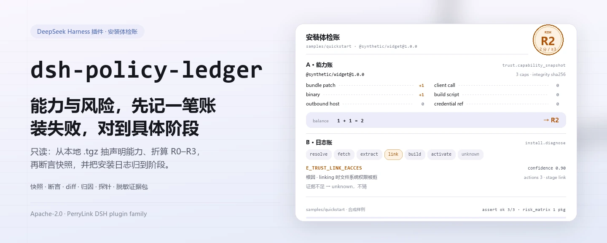
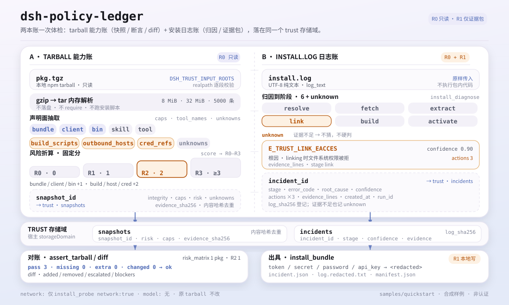

<div align="center">

<picture>
  <source media="(prefers-color-scheme: dark)" srcset="docs/assets/dsh-policy-ledger-hero-zh-dark.webp">
  
</picture>

# dsh-policy-ledger

**在安装第三方 DSH 包之前，先看清它声明了什么能力、风险几级、装失败卡在哪一步——只读，不动你的环境。**

面向 DeepSeek Harness 的只读安装体检插件：本地 npm tarball 抽能力与 R0–R3 风险，逐条断言 tarball 与快照是否一致，并把安装日志归因到阶段、根因和三条下一步动作。

[安装](#三步上手) · [配置](#配置) · [FAQ](#faq) · [简体中文](README.md) · [English](README.en.md) · [Español](README.es.md) · [Português](README.pt.md) · [हिन्दी](README.hi.md)

[](LICENSE)
[](#兼容性)
[](https://www.npmjs.com/package/dsh-policy-ledger)
[](https://github.com/PerryLink/dsh-policy-ledger/actions/workflows/ci.yml)
[](#兼容性)

[](https://github.com/PerryLink/dsh-policy-ledger/stargazers)
[](https://www.npmjs.com/package/dsh-policy-ledger)
[](https://dshfind.com/plugins/PerryLink/dsh-policy-ledger?ref=badge)
[](https://dsh.market/)
[](https://gitee.com/perrylink/dsh-policy-ledger)

```sh
dsh plugin --profile <profile> add dsh-policy-ledger
```

</div>

<sub>社区插件，与 DeepSeek 官方无关。唯一仓库：<https://github.com/PerryLink/dsh-policy-ledger>（Gitee 为镜像）。</sub>

> **状态：alpha / 公开合成 / partial / not counted / 非 GA。** 不含客户证据、客户数据，也不作生产可用声明。

## 它是什么

`dsh-policy-ledger` 在安装第三方 DSH 包之前做一次只读体检：从本地 npm `.tgz` 抽出它声明的能力（tools、bundle/client/bin/skill、构建脚本、出站主机、凭据引用），按固定规则折算成 R0–R3 风险；安装失败时，把日志归因到 `resolve` / `fetch` / `extract` / `link` / `build` / `activate` 中的某一阶段，给出根因和三条下一步动作。输入输出都留在本机：不调用模型，默认不联网，不改原 tarball，也不执行包内代码。它回答的是「装了什么、tarball 里有什么、为什么装失败」，不做包结构检查、Cordis 装配检查和 sandbox smoke——那些属于已归档的 `dsh-plugin-doctor`，需要两类问题时两者都用。

<picture>
  <source media="(prefers-color-scheme: dark)" srcset="docs/assets/dsh-policy-ledger-flow-v5-dark.svg">
  
</picture>

*图：两页账共用 trust 存储域；R0–R3 只折算包声明面，不是安全认证。*

- **适合**：安装第三方 DSH 包前先看它声明了哪些能力与风险；安装失败想读懂日志卡在哪一步；需要一份可以转发的脱敏证据包。
- **不适合**：需要自动执行 tarball、自动修复安装、或替你做放行与拦截决定的场景；本包只做只读诊断，不做策略门禁。

## 三步上手

1. **安装**（三选一）：

   ```sh
   # npm 通道（推荐，已发布版本）
   dsh plugin --profile <profile> add dsh-policy-ledger
   # git 通道（最新 main；等价于 git+https://github.com/PerryLink/dsh-policy-ledger.git）
   dsh plugin --profile <profile> add github:PerryLink/dsh-policy-ledger
   # tarball 通道：本仓库 pnpm pack 后
   dsh plugin --profile <profile> add ./dsh-policy-ledger-<version>.tgz
   ```

2. **最小配置**：没有配置键——`cordis.patch.yml` 只 `insert` 一行，默认即可用。默认只允许读取宿主进程当前工作目录下的 `.tgz` 与安装日志；要换目录就设 `DSH_TRUST_INPUT_ROOTS`（见「配置」）。

3. **验证已生效**：

   ```sh
   dsh --profile <profile> --dump-config | grep dsh-policy-ledger
   node samples/quickstart/run.mjs
   ```

   quickstart 用随包合成样例跑通「能力快照 → tarball 断言 → 风险拆分 → 安装日志归因 → 车队风险矩阵」，并与金标 `samples/quickstart/expected/result.json` 对照。仓库内需先 `pnpm build` 生成 `lib/`（发布包已带构建产物）。

**卸载**：`dsh plugin --profile <profile> remove dsh-policy-ledger`（或从 profile patch 删掉该行）。

<details>
<summary>从 DSH Desktop 市场安装</summary>

所有 PerryLink 插件均可在 DSH Desktop 内置市场中浏览：**市场 → 来源 → 添加来源 → 粘贴** `https://perrylink-dsh-catalog.perrylink.workers.dev/catalog-source.json` **→ 选中**。安装仍需通过市场的 npm 身份校验与你的确认。

</details>

## 核心能力

- **能力快照** —— `trust.capability_snapshot` 从本地 npm `.tgz` 抽取 `name` / `version` / `integrity` / `risk` / `caps` / `tool_names` / `outbound_hosts` / `cred_refs` / `build_scripts` / `unknowns`；tar/gzip 解析全在内存里完成，不落盘、不执行包内代码。
- **风险折算** —— bundle / client / bin 各记 1 分，构建脚本 / 出站主机 / 凭据引用各记 2 分；总分 0 / 1 / 2 / ≥3 对应 R0 / R1 / R2 / R3。`trust.risk_report` 拆开每个因子，`trust.risk_matrix` 给车队视图（各等级计数、最高级、需复核名单）。
- **快照对比** —— `trust.diff` 比较两个已保存快照：新增/移除的能力、风险升级，以及新增构建脚本、凭据引用、出站主机等阻断项。
- **tarball 断言** —— `trust.assert_tarball` 重读 tarball 并与快照比对 package、risk、caps，逐行给出 `pass` / `missing` / `extra` / `changed`；只有全部 `pass` 才 `ok`，绝不把不一致当通过。`trust.assert` 是语义相同的弃用别名。
- **安装日志归因** —— `install.diagnose` 把日志归到 `resolve` / `fetch` / `extract` / `link` / `build` / `activate` / `unknown`，返回 `error_code`、`root_cause`、三条 `actions` 与 `confidence`；证据不足时返回 unknown，不猜。
- **环境探针** —— `install.probe` 检查磁盘可用空间、写权限、代理环境、node/pnpm 版本，并返回 `clock_skew_ms`（当前固定为 0）；只有显式传 `network: true` 才做一次 5 秒超时的 registry 连通性 ping。
- **脱敏证据包** —— `install.bundle` 写出本地 ZIP（`incident.json` / `log.redacted.txt` / `manifest.json`）：日志里的 `token` / `secret` / `password` / `api_key` 值先替换为 `<redacted>`，包内附 sha256 与脱敏命中数；标 R1（本地写）。
- **只读本地** —— 不调用模型，不上传；除 `install.probe` 的显式联网开关外没有任何网络请求。

### 工具面

工具名是稳定 API（与运行时输出一致，保持英文）；说明已本地化。

| 工具 | 用途 | 风险 |
|---|---|---|
| `trust.capability_snapshot` | 从本地 npm `.tgz` 抽取声明能力与 R0–R3 风险：tools、bundle/client/bin/skill、构建脚本、出站主机、凭据引用 | R0 local read |
| `trust.diff` | 比较两个已保存快照：新增/移除的能力、风险升级、阻断项 | R0 |
| `trust.assert_tarball` | 重读 tarball 并与已保存快照比对：pass/missing/extra/changed；不一致绝不当作通过 | R0 |
| `trust.assert` | `trust.assert_tarball` 的弃用别名（语义相同） | R0 |
| `install.diagnose` | 把安装日志归到阶段、根因和三条行动建议；判断不了时返回 unknown | R0 |
| `install.probe` | 检查磁盘可用空间、写权限、代理、可选的 registry RTT、`clock_skew_ms` 与 node/pnpm | R0 |
| `install.bundle` | 写出经脱敏的事件 ZIP（诊断 + 证据行 + manifest 哈希） | R1 local write |
| `trust.risk_report` | 拆解风险分数：每个因子的分值、总分与 R0–R3 结论 | R0 |
| `trust.risk_matrix` | 车队视图：按 R0–R3 计数、最高等级与需要复核的包 | R0 |

### 输入与输出

输入：

- 本地 npm tarball（`.tgz`，由 `npm pack` / `pnpm pack` 生成），必须解析到 `DSH_TRUST_INPUT_ROOTS` 指定的目录（默认当前工作目录）内。
- 安装日志纯文本（UTF-8），原样作为 `log_text` 传入即可。
- 自带样例在 `samples/quickstart/input/`：一个 524 字节的合成 tarball + 一份合成安装日志，远小于 500 KB。
- 硬上限：单个 `.tgz` 8 MiB，解压后 32 MiB、tar 条目 5000 个；超过以 `E_TRUST_ARCHIVE_LIMIT` / `E_TRUST_TARBALL_LIMIT` 拒绝。

输出：

- 能力快照：`snapshot_id`、包名/版本、sha256 完整性、风险等级、能力清单、工具名、出站主机、凭据引用、构建脚本与 `unknowns`。
- tarball 断言：逐条给出 `pass` / `missing` / `extra` / `changed` 与总 `ok`，不会把不一致当成通过。
- 安装诊断：`stage`、`error_code`、`root_cause`、三条 `actions` 与 `confidence`；证据不足时返回 unknown 而不是猜测。
- 可选证据包：`$DSH_HOME/storages/dsh-policy-ledger/bundles/<incident>-<sha>.zip`，日志先脱敏再写入；不改原 tarball。

### 示例

直接复制这句话（`package.json` 里的演示提示词）：

```text
帮我用自带样例做一次安装体检：这个包有什么能力、风险几级、装失败的那行日志是什么原因？
```

也可以自己跑（真实运行，截图即来自这条命令）：

```sh
node samples/quickstart/run.mjs
```

```text
$ node samples/quickstart/run.mjs
dsh-policy-ledger quickstart - synthetic tarball (not a real package)
package @synthetic/widget@1.0.0: risk R2, 3 capabilities
assert: ok (3/3 pass)
risk factors: bundle patch:1, binary:1 -> R2
diagnosis: E_TRUST_LINK_EACCES (stage link, confidence 0.9)
risk matrix: 1 package, highest R2, 1 to review
```


*合成 tarball → 金标 `samples/quickstart/expected/result.json`；命令与哈希见 `screenshots.json`。*

验收：`node scripts/acceptance.mjs` 生成 3 个合成 tarball（safe / medium / risky）与 5 条安装日志；[`ACCEPTANCE.csv`](ACCEPTANCE.csv) 记录 7 行公开检查，除 `PS1-QS01`（quickstart 金标复现，`counted=true`）外全部 `counted=false`。覆盖能力快照 3/3、diff 捕获 1/1、安装日志归因 5/5、证据包 1/1，以及风险因子与风险矩阵的 R3 行。

*以上为 fixture/样例支撑的验收行，非客户运行；完整列（含 `script` 与 `evidence_sha256`）见 [`ACCEPTANCE.csv`](ACCEPTANCE.csv)。*

## 配置

本插件没有 Schemastery 配置键：`cordis.patch.yml` 只 `insert` 一行（`id: dsh-policy-ledger`），默认即可用。运行时可调的只有环境变量：

| 键 | 默认值 | 含义 |
|---|---|---|
| `DSH_TRUST_HOME`（环境变量） | `$DSH_HOME/storages/dsh-policy-ledger` | 证据包 `bundles/*.zip` 与探针写入检查的根目录；未设 `DSH_HOME` 时退回宿主进程 cwd 下的 `storages/dsh-policy-ledger` |
| `DSH_TRUST_INPUT_ROOTS`（环境变量） | 宿主进程 cwd | 允许读取的输入根目录；多个目录用系统路径分隔符（Windows `;`，POSIX `:`）分隔。`.tgz` 与日志必须解析到这些目录内，否则 `E_TRUST_PATH_NOT_ALLOWED` |
| `DSH_HOME`（环境变量） | 宿主注入 | 未设 `DSH_TRUST_HOME` 时作为存储根；快照与事件记录通过 `trust` 存储域持久化，位置由宿主的 storageDomain 管理 |

<details>
<summary>固定上限与落盘位置（无配置键可改）</summary>

| 项 | 值 | 说明 |
|---|---|---|
| 单个 `.tgz` 读入上限 | 8 MiB | 超限先报 `E_TRUST_ARCHIVE_LIMIT`，不会先读进内存再判断 |
| 解压后上限 | 32 MiB | gzip 解压按上限中止，gzip bomb 不会完整展开 |
| tar 条目上限 | 5000 | 超限报 `E_TRUST_TARBALL_LIMIT` |
| 快照/事件记录 | `trust` 存储域（`snapshots` / `incidents` 两张表） | 由宿主 storageDomain 持久化；快照按内容哈希去重 |
| 证据包 | `<baseDir>/bundles/<incident>-<sha12>.zip` | `baseDir` 即 `DSH_TRUST_HOME`；`incident.json` / `log.redacted.txt` / `manifest.json` |
| 原 tarball | 不修改、不解压到磁盘 | 解析只发生在内存中 |

</details>

## FAQ

<details>
<summary>装不上怎么办？</summary>

确认 DSH `>=0.2.1-rc.3 <0.4.0`、Node `>=24.9 <25`，并用全新的 `DSH_HOME` 重试；完整步骤见 [`TROUBLESHOOTING.md`](TROUBLESHOOTING.md)。

</details>

<details>
<summary>为什么样例包是 R2 而不是 R0？</summary>

风险按声明能力累加：bundle patch、client、bin 各 1 分；构建脚本、出站主机、凭据引用各 2 分；2 分就是 R2。样例包同时声明了 bundle 和 bin，所以是 R2。风险等级只是「声明面」的折算，不是安全证明；`unknowns` 与源码仍需人工复核。

</details>

<details>
<summary>路径被拒绝（E_TRUST_PATH_NOT_ALLOWED）怎么办？</summary>

工具只读 `DSH_TRUST_INPUT_ROOTS` 下的文件：路径会先做 `realpath`，再与允许根目录逐段比较。把 tarball 放进该目录，或在该目录里运行 DSH；不要直接把 `/etc/hosts` 这类路径传进来。需要多个目录时用系统路径分隔符配置。

</details>

<details>
<summary>会联网吗？数据存在哪？</summary>

默认不联网、不调用模型、不上传。只有显式调用 `install.probe` 并传 `network: true` 时，才会对 `registry.npmjs.org` 做一次 5 秒超时的连通性 ping；结果不影响其他工具。快照与事件记录写进 `trust` 存储域，证据包写进 `DSH_TRUST_HOME` 下的 `bundles/`，原 tarball 不被修改。

</details>

<details>
<summary>能处理我的真实 npm 包吗？结论能当安全认证吗？</summary>

可以本地运行，但本包是 alpha、只用公开/合成包验证，不构成安全认证或放行结论；真实包请结合源码、发布者与 `unknowns` 人工复核。本包只读诊断，不做拦截。

</details>

<details>
<summary>包太大或解压太大被拒怎么办？</summary>

单个 `.tgz` 上限 8 MiB，解压后 32 MiB、tar 条目 5000；超限分别报 `E_TRUST_ARCHIVE_LIMIT` / `E_TRUST_TARBALL_LIMIT`。换官方发布的小包，或先人工核对内容；不要为了装包直接调大上限。

</details>

## 安全边界

- **默认只读。** 除 `install.bundle` 标 R1（本地写）外，其余工具都是 R0；没有任何自动安装、修复、执行或回滚动作。
- **读取范围受控。** 只读 `DSH_TRUST_INPUT_ROOTS` 下你显式传入的 `.tgz` 与日志文本；`realpath` 后逐段比较，指向目录外的路径直接以 `E_TRUST_PATH_NOT_ALLOWED` 拒绝。
- **不执行包内代码。** tar/gzip 在内存中解析，不落盘、不 `require` 包内模块、不跑 `preinstall` / `postinstall`。
- **写入范围受控。** 只写 `trust` 存储域（快照/事件记录）与 `DSH_TRUST_HOME` 下的 `bundles/*.zip`；不修改原 tarball、不碰其他插件的数据。
- **网络面最小。** 只有 `install.probe` 传 `network: true` 时访问 `registry.npmjs.org` 做一次 5 秒 ping；不调用模型，不上传证据包。
- **失败关闭、结论不猜。** 超限、非法 gzip、缺 `package/package.json`、找不到快照、日志证据不足，都返回明确错误码或 `unknown`，不会静默通过。
- **先脱敏再落盘。** 证据包写入前把 `token` / `secret` / `password` / `api_key` 的值替换为 `<redacted>`，并在 manifest 里记录命中数。

## 已知限制

- **仅公开/合成验证。** alpha / partial / not counted / 非 GA；0 个真实 agent profile、0 次 IT 访谈，无客户数据或客户证据，不作生产可用声明。
- **风险是声明面折算。** R0–R3 只反映包声明了什么（bundle / client / bin / 构建脚本 / 出站主机 / 凭据引用），不证明实际行为安全；`unknowns` 必须人工复核。
- **只认 npm tarball。** 输入必须是 `.tgz`；不扫描已安装的 `node_modules`、目录形态的包或 lockfile。
- **日志归因是模式匹配。** 覆盖 404、EACCES、网络、ENOSPC、peer 依赖、构建脚本、integrity、activate 等常见分支；证据不足时返回 unknown，不猜。
- **输入有硬上限。** 8 MiB 打包 / 32 MiB 解压 / 5000 条目；超大包需要人工先核对。
- **路径被限制在输入根目录内。** 这是安全边界，不是 bug；跨目录读取需要显式配置 `DSH_TRUST_INPUT_ROOTS`。
- **不做策略门禁。** 没有 `install.retry`、没有 Gate/ledger、没有客户端半、没有签名根；不自动修复安装，也不阻止安装。
- **证据包脱敏是正则级的。** 分享前仍应人工检查；本包不承诺识别所有秘密格式。
- **`trust.assert` 已弃用。** 新代码用 `trust.assert_tarball`；两者语义相同。

## 与其他 DSH 插件的互操作性

- **不与 `dsh-plugin-doctor` 重复。** 已归档的 `dsh-plugin-doctor` 做包结构、Cordis 装配与 sandbox smoke；本包做能力快照、tarball 断言与安装日志归因。需要两类问题时两者都用。
- **无工具名冲突。** 所有工具都在 `trust.*` / `install.*` 命名空间下，不占用内置工具或其他插件的裸名。
- **无服务键、slot、HTTP 路由冲突。** 不注册服务键、客户端 slot、`webServer` 前缀；`cordis.patch.yml` 只 `insert` 自己那一行，从不覆写内置行。
- **存储与全局隔离。** 只开自己的 `trust` 存储域、只写自己的 `bundles/`；不改原型、不重写 `process.env`、不替换全局 fetch dispatcher。

## 兼容性

| 维度 | 状态 |
|---|---|
| Harness | `dsh >=0.2.1-rc.3 <0.4.0` |
| Node | `>=24.9.0 <25` |
| 平台 | 任何 DSH 可运行处；仅本地文件 |
| 数据 | 默认不联网、不调用模型、不上传；仅 `install.probe` 传 `network: true` 时 ping registry |

## 生态与质量

- [Gitee 镜像](https://gitee.com/perrylink/dsh-policy-ledger)（同步镜像，以 GitHub 为准）
- [dshfind 插件页](https://dshfind.com/plugins/PerryLink/dsh-policy-ledger)（安装量与排名）
- [DSH Market](https://dsh.market/)（已上架）
- **1024 商店渠道**：先 `npm i -g dsh1024`，再 `dsh1024 plugin --profile <profile> add dsh-policy-ledger`（计入 [deepseek1024.com](https://deepseek1024.com) 安装排行）
- 文档：[`TROUBLESHOOTING.md`](TROUBLESHOOTING.md) · [`PRIVACY.md`](PRIVACY.md) · [`SECURITY.md`](SECURITY.md) · [`EVIDENCE.md`](EVIDENCE.md) · [领域索引](https://perrylink.github.io/dsh-plugins/) · [Checker 家族](https://perrylink.github.io/zh/checkers/)
- 兄弟包：[dsh-pim-lint](https://github.com/PerryLink/dsh-pim-lint) · [dsh-eval-pack](https://github.com/PerryLink/dsh-eval-pack)

## 开发

```sh
pnpm install --frozen-lockfile
pnpm build && pnpm lint && pnpm typecheck && pnpm test   # tsc 构建 + node --test test/*.test.mjs
node scripts/acceptance.mjs                              # 验收（7 行），明细见 ACCEPTANCE.csv
pnpm run pack:check                                      # 发布内容 dry-run 校验
node samples/quickstart/run.mjs --check                  # 合成样例与金标逐字段比对
dsh-policy-ledger doctor <package.tgz> --json            # CLI 直跑能力快照（R3 退出码 2）
```

| 路径 | 内容 |
|---|---|
| `src/core/` | 风险折算、diff、安装日志归因、风险矩阵（纯函数，不依赖 DSH） |
| `src/adapters/` | tar/gzip 解析与能力抽取（内存上限、路径不落盘） |
| `src/plugin/` | Cordis 宿主面：工具注册、`trust` 存储域、证据包写入 |
| `bin/` | CLI `dsh-policy-ledger doctor <pkg.tgz> [--json]` |
| `test/` | `node --test`（构建后跑） |
| `samples/quickstart/` | 合成 tarball + 安装日志 + 金标 |
| `scripts/` | 验收、打包检查、配图生成 |
| `evidence/` | 每次验收运行的 `result.json`（本地证据，不随包发布） |

TypeScript 源码在 `src/`，构建产物在 `lib/`。hero 与结构图由 [`scripts/gen-readme-assets.py`](scripts/gen-readme-assets.py) 程序化生成（Python 3 + Pillow 渲染 hero WebP，SVG 结构图直接手写；输出 `docs/assets/dsh-policy-ledger-hero-{zh,en}-{light,dark}.webp` 与 `dsh-policy-ledger-flow-v5-{light,dark}.svg`），可重复执行。

Topics：`deepseek-harness`, `dsh`, `dsh-plugin`, `trust`, `install-doctor`, `capability-snapshot`, `perrylink`, `security`

## 家族与致谢

本项目是 [PerryLink](https://github.com/PerryLink) 维护的 DeepSeek Harness 插件家族成员（全部 Apache-2.0）。如果这个插件帮到了你，**给个 star**——它不解锁任何功能，但会让下一个人更容易找到它。

- [@PerryLink](https://github.com/PerryLink) —— 创建者与维护者：tarball 能力抽取、R0–R3 风险折算、快照断言与 diff、安装日志归因、脱敏证据包与五语文档。

## License

[LICENSE](LICENSE)（Apache License 2.0）© 2026 dsh-policy-ledger contributors；另见 `NOTICE` 与 `THIRD-PARTY-NOTICES`。

<p align="center"><sub>Apache-2.0 · 社区插件，与 DeepSeek 无关。</sub></p>
