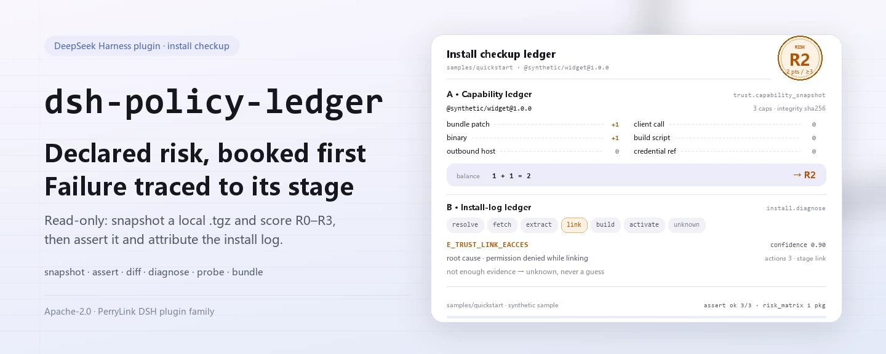
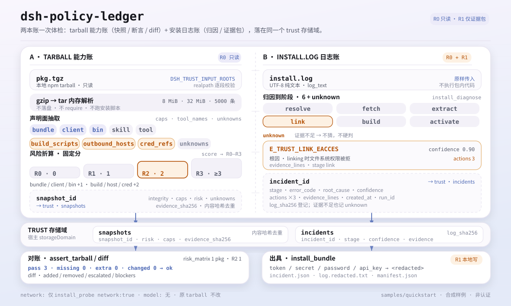

<div align="center">

<picture>
  <source media="(prefers-color-scheme: dark)" srcset="docs/assets/dsh-policy-ledger-hero-en-dark.webp">
  
</picture>

# dsh-policy-ledger

**Antes de instalar um pacote DSH de terceiros, veja quais capacidades ele declara, qual é o nível de risco e por que a instalação falhou — somente leitura e sem tocar no seu ambiente.**

Um doutor de instalação somente leitura para o DeepSeek Harness: extrai as capacidades declaradas e o risco R0–R3 de um tarball npm local, confere o tarball contra um snapshot guardado linha a linha e classifica um log de instalação em estágio, causa raiz e três próximas ações.

[Instalar](#instalação-em-três-passos) · [Configuração](#configuração) · [FAQ](#faq) · [简体中文](README.md) · [English](README.en.md) · [Español](README.es.md) · [Português](README.pt.md) · [हिन्दी](README.hi.md)

[](LICENSE)
[](#compatibilidade)
[](https://www.npmjs.com/package/dsh-policy-ledger)
[](https://github.com/PerryLink/dsh-policy-ledger/actions/workflows/ci.yml)
[](#compatibilidade)

[](https://github.com/PerryLink/dsh-policy-ledger/stargazers)
[](https://www.npmjs.com/package/dsh-policy-ledger)
[](https://dshfind.com/plugins/PerryLink/dsh-policy-ledger?ref=badge)
[](https://dsh.market/)
[](https://gitee.com/perrylink/dsh-policy-ledger)

```sh
dsh plugin --profile <profile> add dsh-policy-ledger
```

</div>

<sub>Plugin comunitário, sem afiliação com a DeepSeek. Repositório canônico: <https://github.com/PerryLink/dsh-policy-ledger> (o Gitee é um espelho).</sub>

> **Status: alpha / sintético público / parcial / não contabilizado / não GA.** Sem evidência de clientes, dados de clientes ou promessa de produção.

## O que é

O `dsh-policy-ledger` faz uma revisão somente leitura antes de instalar um pacote DSH de terceiros: extrai o que o `.tgz` npm local declara (ferramentas, bundle/client/bin/skill, scripts de build, hosts de saída, referências a credenciais) e converte isso num nível de risco R0–R3 por regras fixas. Quando uma instalação falha, classifica o log em um dos estágios `resolve` / `fetch` / `extract` / `link` / `build` / `activate` e devolve a causa raiz e três próximas ações. Entrada e saída ficam na sua máquina: sem chamadas a modelo, sem rede por padrão, o tarball original não é modificado e nenhum código do pacote é executado. Ele responde «o que está instalado, o que o tarball contém, por que a instalação falhou», não a checagens de estrutura de pacote, fiação do Cordis ou sandbox smoke — isso é papel do arquivado `dsh-plugin-doctor`; use os dois quando precisar das duas respostas.

<picture>
  <source media="(prefers-color-scheme: dark)" srcset="docs/assets/dsh-policy-ledger-flow-v5-dark.svg">
  
</picture>

*Figura: os dois livros compartilham o domínio de armazenamento trust; R0–R3 pontua apenas a superfície declarada, não é certificação de segurança.*

- **Indicado para**: ver capacidades e risco declarados antes de instalar um pacote DSH de terceiros; ler um log de instalação para saber onde parou; produzir um pacote de incidente redigido que você possa encaminhar.
- **Não indicado para**: executar automaticamente um tarball, reparar uma instalação ou tomar por você uma decisão de permitir ou bloquear; este pacote diagnostica em somente leitura e não é uma porta de políticas.

## Instalação em três passos

1. **Instale** (escolha um canal):

   ```sh
   # canal npm (recomendado; versões publicadas)
   dsh plugin --profile <profile> add dsh-policy-ledger
   # canal git (último main; equivale a git+https://github.com/PerryLink/dsh-policy-ledger.git)
   dsh plugin --profile <profile> add github:PerryLink/dsh-policy-ledger
   # canal tarball: após pnpm pack neste repositório
   dsh plugin --profile <profile> add ./dsh-policy-ledger-<version>.tgz
   ```

2. **Configuração mínima**: não há chaves de configuração — o `cordis.patch.yml` apenas faz `insert` de uma linha e os padrões bastam. Por padrão, só `.tgz` e logs de instalação sob o diretório de trabalho do processo host são legíveis; para mudar isso, defina `DSH_TRUST_INPUT_ROOTS` (veja «Configuração»).

3. **Verifique se funciona**:

   ```sh
   dsh --profile <profile> --dump-config | grep dsh-policy-ledger
   node samples/quickstart/run.mjs
   ```

   O quickstart executa snapshot de capacidades → asserção do tarball → detalhamento de risco → diagnóstico do log → matriz de risco da frota sobre o exemplo sintético incluído e compara com o padrão ouro `samples/quickstart/expected/result.json`. No repositório, rode `pnpm build` antes para gerar `lib/` (o pacote publicado já inclui o build).

**Desinstalar**: `dsh plugin --profile <profile> remove dsh-policy-ledger` (ou remova a linha do patch do perfil).

<details>
<summary>Instalar pelo mercado do DSH Desktop</summary>

Todos os plugins PerryLink estão no mercado embutido do DSH Desktop: **Mercado → Fontes → Adicionar fonte → colar** `https://perrylink-dsh-catalog.perrylink.workers.dev/catalog-source.json` **→ selecionar**. A instalação continua exigindo a verificação de identidade npm do mercado e a sua confirmação.

</details>

## Capacidades principais

- **Snapshot de capacidades** — `trust_capability_snapshot` extrai de um `.tgz` npm local `name` / `version` / `integrity` / `risk` / `caps` / `tool_names` / `outbound_hosts` / `cred_refs` / `build_scripts` / `unknowns`; a análise tar/gzip acontece só em memória, não grava em disco nem executa código do pacote.
- **Detalhamento de risco** — bundle / client / bin valem 1 ponto cada; scripts de build / hosts de saída / referências a credenciais valem 2 cada; total 0 / 1 / 2 / ≥3 corresponde a R0 / R1 / R2 / R3. `trust_risk_report` explica cada fator e `trust_risk_matrix` fornece a visão de frota (contagem por nível, nível mais alto e lista a revisar).
- **Comparação de snapshots** — `trust_diff` compara dois snapshots guardados: capacidades adicionadas/removidas, escalonamento de risco e bloqueadores como um novo script de build, referência a credencial ou host de saída.
- **Asserção do tarball** — `trust_assert_tarball` relê um tarball e compara pacote, risco e capacidades linha a linha, com linhas `pass` / `missing` / `extra` / `changed`; só é `ok` quando todas passam e nunca trata uma divergência como aprovação. `trust_assert` é um alias obsoleto com a mesma semântica.
- **Diagnóstico do log de instalação** — `install_diagnose` mapeia o log para `resolve` / `fetch` / `extract` / `link` / `build` / `activate` / `unknown` e devolve `error_code`, `root_cause`, três `actions` e `confidence`; quando a evidência não basta, devolve unknown em vez de adivinhar.
- **Sonda de ambiente** — `install_probe` verifica espaço livre, permissão de escrita, proxy, versões de node/pnpm, e devolve `clock_skew_ms` (atualmente fixo em 0); apenas com `network: true` explícito faz um ping ao registry com timeout de 5 segundos.
- **Pacote de incidente redigido** — `install_bundle` grava um ZIP local (`incident.json` / `log.redacted.txt` / `manifest.json`): valores de `token` / `secret` / `password` / `api_key` no log são trocados por `<redacted>` e o pacote leva sha256 e a contagem de redações; marcado R1 (escrita local).
- **Somente leitura e local** — sem chamadas a modelo, sem uploads e sem nenhuma requisição de rede exceto o opt-in explícito de `install_probe`.

### Superfície de ferramentas

Os nomes das ferramentas são a API estável (mantidos em inglês para coincidir com a saída do runtime; os segmentos são unidos com sublinhado porque o provedor valida `tools[].name` com `^[a-zA-Z0-9_-]+$`).

| Ferramenta | Finalidade | Risco |
|---|---|---|
| `trust_capability_snapshot` | Extrai as capacidades declaradas e o risco R0–R3 de um `.tgz` npm local: ferramentas, bundle/client/bin/skill, scripts de build, hosts de saída e referências a credenciais | R0 local read |
| `trust_diff` | Compara dois snapshots guardados: capacidades adicionadas/removidas, escalonamento de risco e bloqueadores | R0 |
| `trust_assert_tarball` | Relê um tarball e o compara com um snapshot guardado: pass/missing/extra/changed; divergência nunca é aprovação | R0 |
| `trust_assert` | Alias obsoleto de `trust_assert_tarball` (mesma semântica) | R0 |
| `install_diagnose` | Classifica um log de instalação em estágio, causa raiz e três ações; devolve unknown em vez de supor | R0 |
| `install_probe` | Verifica espaço livre, permissão de escrita, proxy, RTT de registry opcional, `clock_skew_ms` e node/pnpm | R0 |
| `install_bundle` | Grava um ZIP de incidente redigido (diagnóstico + linhas de evidência + hashes do manifest) | R1 local write |
| `trust_risk_report` | Detalha a pontuação de risco: pontos por fator, total e veredito R0–R3 | R0 |
| `trust_risk_matrix` | Visão de frota: contagem por R0–R3, nível mais alto e pacotes a revisar | R0 |

### Entrada e saída

Entrada:

- Um tarball npm local (`.tgz`, gerado por `npm pack` / `pnpm pack`) que resolva sob os diretórios de `DSH_TRUST_INPUT_ROOTS` (padrão: o diretório de trabalho).
- O log de instalação como texto UTF-8 sem transformação, passado tal como está em `log_text`.
- O exemplo incluído fica em `samples/quickstart/input/`: um tarball sintético de 524 bytes e um log de instalação sintético, bem abaixo de 500 KB.
- Limites rígidos: 8 MiB por `.tgz`, 32 MiB descomprimido e 5000 entradas tar; ao ultrapassar, são lançados `E_TRUST_ARCHIVE_LIMIT` / `E_TRUST_TARBALL_LIMIT`.

Saída:

- Um snapshot de capacidades: `snapshot_id`, nome/versão, integridade sha256, nível de risco, lista de capacidades, nomes de ferramentas, hosts de saída, referências a credenciais, scripts de build e `unknowns`.
- Uma asserção do tarball: linhas `pass` / `missing` / `extra` / `changed` e um `ok` global; divergência nunca é informada como aprovação.
- Um diagnóstico de instalação: `stage`, `error_code`, `root_cause`, três `actions` e `confidence`; unknown quando a evidência não basta.
- Um pacote de incidente opcional em `$DSH_HOME/storages/dsh-policy-ledger/bundles/<incident>-<sha>.zip`; o log é redigido antes de ser gravado e o tarball original não é modificado.

### Exemplos

Copie este prompt tal como está (o prompt de demonstração do `package.json`):

```text
帮我用自带样例做一次安装体检：这个包有什么能力、风险几级、装失败的那行日志是什么原因？
```

Ou rode você mesmo (execução real; a captura vem deste comando):

```sh
node samples/quickstart/run.mjs
```

```text
$ node samples/quickstart/run.mjs
dsh-policy-ledger quickstart - synthetic tarball (not a real package)
package @synthetic/widget@1.0.0: risk R2, 3 capabilities
assert: ok (3/3 pass)
risk factors: bundle patch:1, binary:1 -> R2
diagnosis: E_TRUST_LINK_EACCES (stage link, confidence 0.9)
risk matrix: 1 package, highest R2, 1 to review
```


*Tarball sintético → padrão ouro `samples/quickstart/expected/result.json`; comando e hashes em `screenshots.json`.*

Aceitação: `node scripts/acceptance.mjs` gera 3 tarballs sintéticos (safe / medium / risky) e 5 logs de instalação; [`ACCEPTANCE.csv`](ACCEPTANCE.csv) registra 7 verificações públicas, todas `counted=false` exceto `PS1-QS01` (repetição do padrão ouro do quickstart, `counted=true`). Cobertura: snapshot de capacidades 3/3, captura de diff 1/1, diagnóstico de log 5/5, pacote de incidente 1/1, além das linhas R3 de fatores e matriz de risco.

*Estas são linhas de aceitação respaldadas por fixtures/exemplos, não execuções de clientes; as colunas completas (incl. `script` e `evidence_sha256`) estão em [`ACCEPTANCE.csv`](ACCEPTANCE.csv).*

## Configuração

Este plugin não tem chaves de configuração Schemastery: o `cordis.patch.yml` apenas faz `insert` de uma linha (`id: dsh-policy-ledger`) e os padrões bastam. Apenas variáveis de ambiente são ajustáveis:

| Chave | Padrão | Significado |
|---|---|---|
| `DSH_TRUST_HOME` (variável de ambiente) | `$DSH_HOME/storages/dsh-policy-ledger` | Raiz de `bundles/*.zip` e da checagem de escrita do `install_probe`; sem `DSH_HOME`, cai para `storages/dsh-policy-ledger` sob o cwd do processo host |
| `DSH_TRUST_INPUT_ROOTS` (variável de ambiente) | cwd do processo host | Raízes de entrada permitidas; separe vários diretórios com o delimitador de caminho da plataforma (Windows `;`, POSIX `:`). Um `.tgz` ou log deve resolver dentro de uma delas ou é lançado `E_TRUST_PATH_NOT_ALLOWED` |
| `DSH_HOME` (variável de ambiente) | injetado pelo host | Raiz de armazenamento quando `DSH_TRUST_HOME` não está definido; snapshots e incidentes persistem no domínio `trust`, cujo local é gerenciado pelo storageDomain do host |

<details>
<summary>Limites fixos e locais de escrita (nenhuma chave de configuração os altera)</summary>

| Item | Valor | Significado |
|---|---|---|
| Tamanho máximo de `.tgz` lido | 8 MiB | Verificado antes da leitura; acima disso é lançado `E_TRUST_ARCHIVE_LIMIT` |
| Tamanho máximo descomprimido | 32 MiB | A descompressão gzip aborta no limite, então uma gzip bomb não chega a se materializar |
| Entradas tar máximas | 5000 | Acima disso é lançado `E_TRUST_TARBALL_LIMIT` |
| Snapshots / incidentes | Domínio de armazenamento `trust` (tabelas `snapshots` / `incidents`) | Persistidos pelo storageDomain do host; snapshots são deduplicados por hash de conteúdo |
| Pacote de incidente | `<baseDir>/bundles/<incident>-<sha12>.zip` | `baseDir` é `DSH_TRUST_HOME`; contém `incident.json` / `log.redacted.txt` / `manifest.json` |
| Tarball original | nunca é modificado nem extraído para disco | A análise acontece só em memória |

</details>

## FAQ

<details>
<summary>A instalação falha — e agora?</summary>

Verifique se o DSH é `>=0.2.1-rc.3 <0.4.0` e o Node `>=24.9 <25`, e tente de novo com um `DSH_HOME` novo; os passos completos estão em [`TROUBLESHOOTING.md`](TROUBLESHOOTING.md).

</details>

<details>
<summary>Por que o pacote de exemplo é R2 e não R0?</summary>

O risco é a soma das capacidades declaradas: bundle patch, client e bin valem 1 cada; scripts de build, hosts de saída e referências a credenciais valem 2 cada; pontuação 2 é R2. O pacote de exemplo declara bundle e bin, daí R2. O nível é uma pontuação baseada em declarações, não uma prova de segurança; revise também os `unknowns` e o código.

</details>

<details>
<summary>Recebi E_TRUST_PATH_NOT_ALLOWED — o que fazer?</summary>

As ferramentas só leem arquivos sob `DSH_TRUST_INPUT_ROOTS`: o caminho é resolvido com `realpath` e comparado segmento a segmento com as raízes permitidas. Coloque o tarball dentro de um desses diretórios ou rode o DSH ali; não passe caminhos como `/etc/hosts`. Use o delimitador de caminho da plataforma para várias raízes.

</details>

<details>
<summary>Usa rede? Onde os dados ficam?</summary>

Por padrão não há rede, chamada a modelo nem upload. Apenas uma chamada explícita a `install_probe` com `network: true` faz um ping em `registry.npmjs.org` com timeout de 5 segundos; o resultado não afeta as demais ferramentas. Snapshots e incidentes vão para o domínio `trust`, os pacotes de incidente para `bundles/` sob `DSH_TRUST_HOME`, e o tarball original nunca é modificado.

</details>

<details>
<summary>Posso processar meus pacotes npm reais? O resultado é uma certificação de segurança?</summary>

Roda localmente, mas o pacote é alpha e validado apenas com pacotes públicos/sintéticos — não é certificação de segurança nem decisão de permissão. Para pacotes reais, revise à mão o código, o publicador e os `unknowns`. Este pacote diagnostica em somente leitura e nunca bloqueia uma instalação.

</details>

<details>
<summary>O pacote é grande demais ou passa do limite descomprimido — o que fazer?</summary>

Os limites são 8 MiB por `.tgz`, 32 MiB descomprimido e 5000 entradas tar; ao ultrapassar, são lançados `E_TRUST_ARCHIVE_LIMIT` / `E_TRUST_TARBALL_LIMIT`. Use um pacote oficial menor ou inspecione à mão primeiro; não aumente os limites só para conseguir uma instalação.

</details>

## Limites de segurança

- **Somente leitura por padrão.** Todas as ferramentas são R0 exceto `install_bundle` (R1, escrita local); não há instalação, reparo, execução ou rollback automáticos.
- **Escopo de leitura controlado.** Só são lidos o `.tgz` e o texto do log que você passa sob `DSH_TRUST_INPUT_ROOTS`; caminhos são resolvidos com `realpath` e comparados segmento a segmento, então o que estiver fora lança `E_TRUST_PATH_NOT_ALLOWED`.
- **Nenhum código do pacote é executado.** tar/gzip é analisado em memória — nada é extraído para disco, nenhum módulo do pacote é `require` e scripts `preinstall` / `postinstall` nunca rodam.
- **Escopo de escrita controlado.** Só são gravados o domínio `trust` (snapshots/incidentes) e `bundles/*.zip` sob `DSH_TRUST_HOME`; o tarball original e os dados de outros plugins ficam intactos.
- **Superfície de rede mínima.** Apenas `install_probe` com `network: true` contata `registry.npmjs.org` para um ping de 5 segundos; sem chamadas a modelo e sem upload de pacotes de incidente.
- **Falha fechada, nunca adivinhar.** Entrada grande demais, gzip inválido, falta de `package/package.json`, snapshot desconhecido ou evidência insuficiente produzem código de erro explícito ou `unknown`, nunca uma aprovação silenciosa.
- **Redigir antes de gravar.** Antes de gravar um pacote de incidente, valores de `token` / `secret` / `password` / `api_key` são trocados por `<redacted>` e a contagem é registrada no manifest.

## Limitações conhecidas

- **Apenas validação pública/sintética.** alpha / parcial / não contabilizado / não GA; 0 perfis de agente reais e 0 entrevistas de TI, sem dados ou evidência de clientes, e sem promessa de produção.
- **O risco é uma pontuação baseada em declarações.** R0–R3 reflete só o que o pacote declara (bundle / client / bin / scripts de build / hosts de saída / referências a credenciais), não o comportamento real; os `unknowns` exigem revisão humana.
- **Apenas tarballs npm.** A entrada deve ser um `.tgz`; não são varridos `node_modules` instalados, pacotes em diretório nem lockfiles.
- **O diagnóstico do log é por padrões.** Cobre os ramos 404, EACCES, rede, ENOSPC, conflito de peer, script de build, integridade e activate; se a evidência não basta, devolve unknown em vez de adivinhar.
- **Limites rígidos de entrada.** 8 MiB empacotado / 32 MiB descomprimido / 5000 entradas; pacotes grandes precisam de inspeção manual antes.
- **Caminhos confinados às raízes de entrada.** É uma fronteira de segurança, não um bug; ler fora exige configurar `DSH_TRUST_INPUT_ROOTS`.
- **Não é uma porta de políticas.** Não há `install_retry`, nem Gate/ledger, nem metade de cliente, nem raiz de assinatura; não repara nem bloqueia instalações.
- **A redação do pacote é em nível de regex.** Revise antes de compartilhar; este pacote não promete reconhecer todos os formatos de segredo.
- **`trust_assert` está obsoleto.** Código novo deve usar `trust_assert_tarball`; a semântica é idêntica.

## Interoperabilidade com outros plugins DSH

- **Sem sobreposição com o `dsh-plugin-doctor`.** O arquivado `dsh-plugin-doctor` fazia checagens de estrutura de pacote, fiação do Cordis e sandbox smoke; este pacote faz snapshots de capacidades, asserções de tarball e diagnóstico de logs. Use os dois quando precisar das duas respostas.
- **Sem colisão de nome de ferramenta.** Todas as ferramentas estão nos namespaces `trust_*` / `install_*`; nenhum nome nu de ferramenta embutida ou de outro plugin é registrado.
- **Sem colisão de chave de serviço, slot ou rota HTTP.** Não registra chave de serviço, slot de cliente nem prefixo `webServer`; o `cordis.patch.yml` apenas faz `insert` da própria linha e nunca sobrescreve uma linha embutida.
- **Armazenamento e globais isolados.** Abre só o próprio domínio `trust` e grava só o próprio `bundles/`; não altera protótipos, não reescreve `process.env` nem substitui o dispatcher global de fetch.

## Compatibilidade

| Superfície | Status |
|---|---|
| Harness | `dsh >=0.2.1-rc.3 <0.4.0` |
| Node | `>=24.9.0 <25` |
| Plataformas | Onde o DSH rodar; apenas arquivos locais |
| Dados | Sem rede, sem chamada a modelo e sem upload por padrão; apenas `install_probe` com `network: true` faz ping no registry |

## Ecossistema e qualidade

- [Espelho no Gitee](https://gitee.com/perrylink/dsh-policy-ledger) (espelho sincronizado; o GitHub é o canônico)
- [Página do plugin no dshfind](https://dshfind.com/plugins/PerryLink/dsh-policy-ledger) (instalações e ranking)
- [DSH Market](https://dsh.market/) (listado)
- **Canal da loja 1024**: `npm i -g dsh1024` uma vez e depois `dsh1024 plugin --profile <profile> add dsh-policy-ledger` (conta para o ranking de instalações do [deepseek1024.com](https://deepseek1024.com))
- Documentação: [`TROUBLESHOOTING.md`](TROUBLESHOOTING.md) · [`PRIVACY.md`](PRIVACY.md) · [`SECURITY.md`](SECURITY.md) · [`EVIDENCE.md`](EVIDENCE.md) · [Índice de domínio](https://perrylink.github.io/dsh-plugins/) · [Família de checkers](https://perrylink.github.io/zh/checkers/)
- Pacotes irmãos: [dsh-pim-lint](https://github.com/PerryLink/dsh-pim-lint) · [dsh-eval-pack](https://github.com/PerryLink/dsh-eval-pack)

## Desenvolvimento

```sh
pnpm install --frozen-lockfile
pnpm build && pnpm lint && pnpm typecheck && pnpm test   # build tsc + node --test test/*.test.mjs
node scripts/acceptance.mjs                              # aceitação (7 linhas), detalhes em ACCEPTANCE.csv
pnpm run pack:check                                      # checagem dry-run do conteúdo publicado
node samples/quickstart/run.mjs --check                  # compara o exemplo sintético com o padrão ouro
dsh-policy-ledger doctor <package.tgz> --json            # snapshot de capacidades pela CLI (código de saída 2 para R3)
```

| Caminho | Conteúdo |
|---|---|
| `src/core/` | Pontuação de risco, diff, diagnóstico de logs, matriz de risco (funções puras, sem dependência de DSH) |
| `src/adapters/` | Análise tar/gzip e extração de capacidades (limites de memória, nada gravado em disco) |
| `src/plugin/` | Face host do Cordis: registro de ferramentas, domínio `trust`, gravação de pacotes de incidente |
| `bin/` | CLI `dsh-policy-ledger doctor <pkg.tgz> [--json]` |
| `test/` | `node --test` (após o build) |
| `samples/quickstart/` | Tarball sintético + log de instalação + padrão ouro |
| `scripts/` | Aceitação, checagens de empacotamento, geração de assets |
| `evidence/` | `result.json` de cada execução de aceitação (local, não publicado) |

Os fontes TypeScript ficam em `src/` e o build em `lib/`. O hero e o diagrama de estrutura são gerados por [`scripts/gen-readme-assets.py`](scripts/gen-readme-assets.py) (Python 3 + Pillow para o hero WebP; o SVG é escrito à mão; saídas `docs/assets/dsh-policy-ledger-hero-{zh,en}-{light,dark}.webp` e `dsh-policy-ledger-flow-v5-{light,dark}.svg`) e podem ser reexecutados com segurança.

Topics: `deepseek-harness`, `dsh`, `dsh-plugin`, `trust`, `install-doctor`, `capability-snapshot`, `perrylink`, `security`

## Família e agradecimentos

Este projeto faz parte da família de plugins do DeepSeek Harness da [PerryLink](https://github.com/PerryLink) (todos Apache-2.0). Se for útil, **uma estrela ajuda a próxima pessoa a encontrá-lo** — nada fica bloqueado atrás dela.

- [@PerryLink](https://github.com/PerryLink) — criador e mantenedor: extração de capacidades do tarball, pontuação de risco R0–R3, asserção e diff de snapshots, diagnóstico de logs de instalação, pacote de incidente redigido e documentação em cinco idiomas.

## Licença

[LICENSE](LICENSE) (Apache License 2.0) © 2026 dsh-policy-ledger contributors; veja também `NOTICE` e `THIRD-PARTY-NOTICES`.

<p align="center"><sub>Apache-2.0 · Plugin comunitário, sem afiliação com a DeepSeek.</sub></p>
